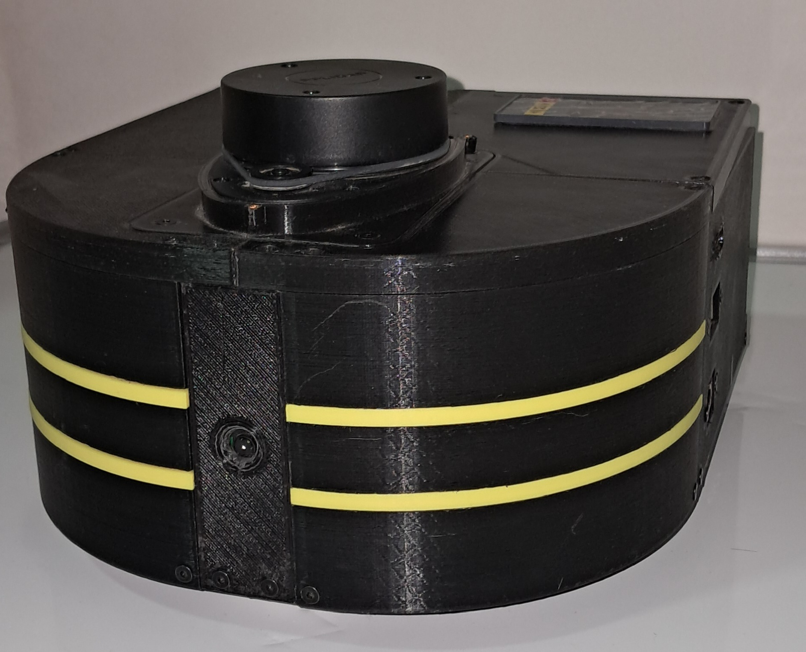
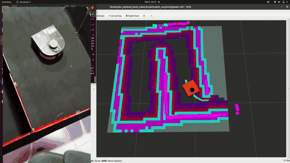
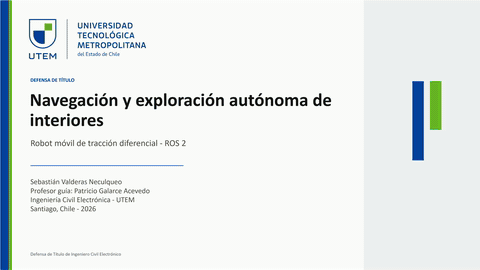
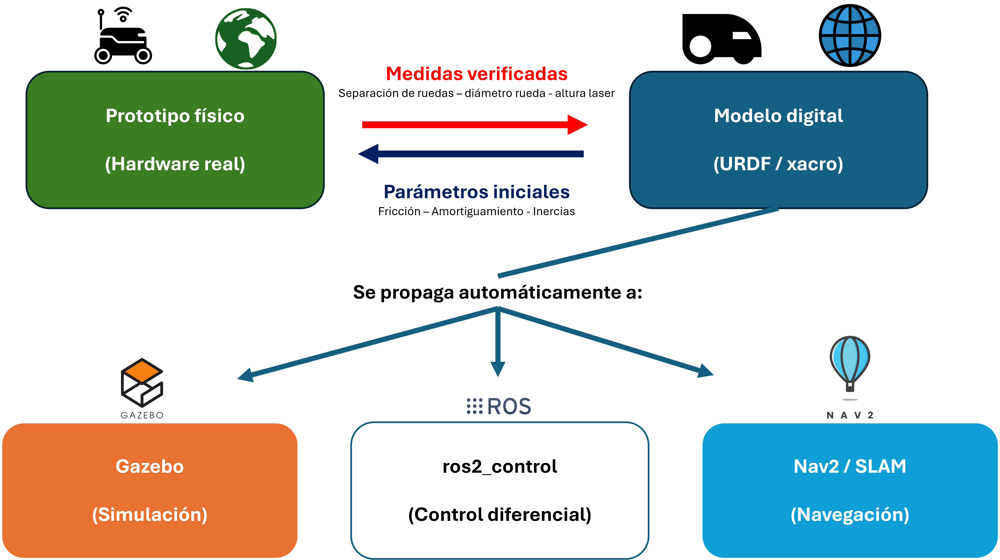
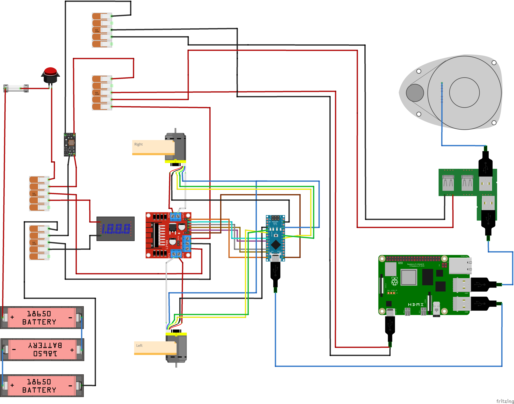
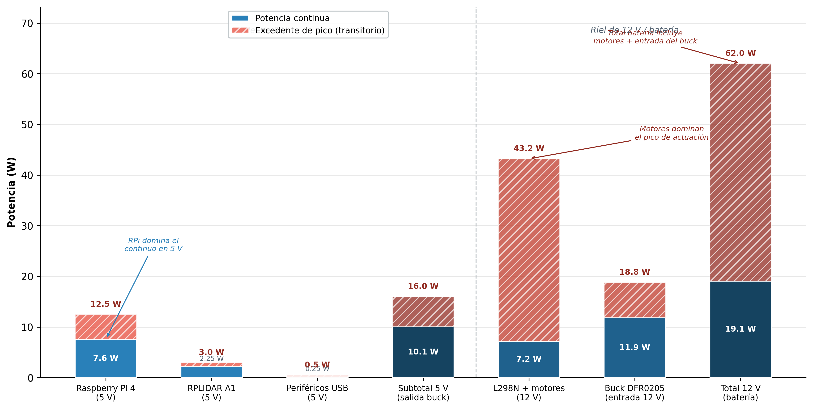
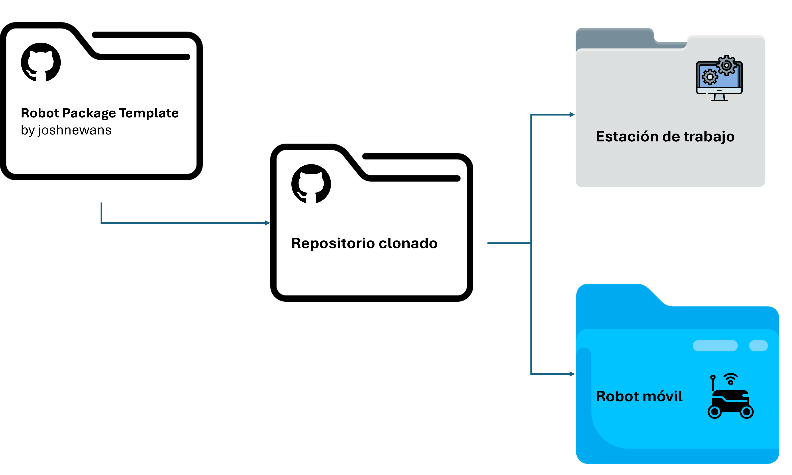

# Navegación y exploración autónoma de interiores con un robot móvil diferencial

Versión en inglés: [docs/overview.en.md](docs/overview.en.md)

Workspace de ROS 2 del trabajo de titulación de Ingeniería Civil Electrónica en la Universidad Tecnológica Metropolitana (UTEM, 2026). Un robot diferencial de bajo costo construye un mapa 2D de un recinto con SLAM y lo explora solo, yendo hacia fronteras que genera de forma automática.

**Estado:** terminado. El código y los datos corresponden a la versión final de la tesis.

<p align="center">
  
  <a href="https://github.com/SVN11X/ros2-indoor-exploration-robot/releases/download/demo-videos/2026-02-10-exploration-modular-arena.mp4"></a>
</p>

<p align="center"><em>El prototipo y una exploración autónoma en la arena modular de pruebas. Haz clic en la animación para ver el video completo.</em></p>

<p align="center"><a href="https://github.com/SVN11X/ros2-indoor-exploration-robot/releases/download/demo-videos/2026-09-20-thesis-summary.mp4"></a></p>

<p align="center"><em>La tesis en 60 segundos: objetivos, robot real y simulado, arquitectura, resultados y conclusiones. Haz clic para ver el video.</em></p>

## Qué hace

- Mapeo 2D con SLAM Toolbox y un RPLidar A1.
- Navegación autónoma con Nav2.
- Exploración por fronteras con m-explore, sin intervención manual.
- Gemelo digital en Gazebo Classic 11 para probar todo antes del robot real.
- Control de velocidad de cada rueda en un Arduino Nano, con ganancias obtenidas por PSO (optimización por enjambre de partículas).

Resultados principales de la tesis: error medio de odometría de 3,63 % en línea recta, mapas válidos en 5 de 6 exploraciones y una distancia media de 3,4 cm entre los mapas y el plano medido del recinto.

<p align="center"></p>

<p align="center"><em>El gemelo digital: el modelo URDF y xacro toma las medidas verificadas del robot real (separación y diámetro de las ruedas, altura del láser), y Gazebo, ros2_control y Nav2 con SLAM usan ese mismo modelo.</em></p>

## Hardware

Raspberry Pi 4, Arduino Nano, driver L298N, dos motores DC con encoders de cuadratura, rueda loca y RPLidar A1. El chasis y las cubiertas están impresos en 3D con PLA+.

<p align="center"><a href="mechanical/README.md"></a></p>

<p align="center"><em>1 RPLidar A1, 2 cámara Raspberry Pi v2.1 (la tesis no la usa), 3 Arduino Nano, 4 placa de bornes, 5 separadores y 6 driver L298N. Los modelos 3D del robot y de cada componente están en <a href="mechanical/README.md">mechanical/</a>.</em></p>

|  |  |
| --- | --- |
|  |  |
| Conexiones eléctricas y de datos, dibujadas en Fritzing. | Consumo continuo y de pico de cada componente. Los motores dominan el pico del riel de 12 V. |

Las fotos de cada componente están en [docs/images/](docs/images/README.md#componentes).

## Software

Ubuntu 20.04 LTS, ROS 2 Foxy y Gazebo Classic 11. La combinación se congeló al inicio del proyecto para asegurar la compatibilidad de todos los paquetes.

## Estructura

```text
.
├── src/                  paquetes de ROS 2 que compila colcon
│   ├── articubot_one/    modelo del robot, launch y parámetros
│   ├── serial_motor_demo/
│   └── third_party/      paquetes de otros proyectos
├── firmware/             firmware del Arduino Nano y sintonización del PID
├── mechanical/           modelos 3D del robot y de sus componentes
├── scripts/
│   ├── launch/           arranque del robot, la simulación y el mapeo
│   └── robot-setup/      diagnóstico y ajustes de la Raspberry Pi
├── experiments/          pruebas de la tesis con sus resultados
└── docs/                 guías de instalación, imágenes, costos y documentación
```

La tesis cita las rutas como estaban antes de este orden, por ejemplo `src/test/...`. La tabla de equivalencias está en [docs/thesis-paths.md](docs/thesis-paths.md).

## Instalación

<p align="center"></p>

El repositorio parte de la plantilla de paquetes de robot de joshnewans y se clona dos veces: en el PC (estación de trabajo) y en la Raspberry Pi del robot.

1. Instala Ubuntu 20.04 y ROS 2 Foxy con las guías de [docs/robot-setup/](docs/robot-setup/README.md).
2. Instala Git LFS antes de clonar, porque los archivos grandes de las sesiones de mapeo están ahí:

   ```bash
   sudo apt install git-lfs
   git lfs install
   ```

3. Clona el repositorio. En el PC queda como `~/tesis_black_robot` y en la Raspberry Pi como `~/robot_ws`, que son las rutas que usan los scripts:

   ```bash
   git clone https://github.com/SVN11X/ros2-indoor-exploration-robot.git ~/tesis_black_robot
   ```

4. Compila desde la raíz del workspace:

   ```bash
   rosdep install --from-paths src --ignore-src -r -y
   colcon build --symlink-install
   source install/setup.bash
   ```

5. Carga `firmware/ROSArduinoBridge/ROSArduinoBridge.ino` en el Arduino Nano con el IDE de Arduino.

## Uso

Simulación en el PC:

```bash
bash scripts/launch/launch_sim_all.sh
```

Robot real. Primero en la Raspberry Pi y después en el PC:

```bash
bash ~/robot_ws/scripts/launch/launch_robot_all.sh
bash ~/tesis_black_robot/scripts/launch/launch_mapeo_all.sh
```

Cada prueba de la tesis está en `experiments/` con su script `run_*.sh`. El flujo completo está explicado en [docs/how-it-works.md](docs/how-it-works.md).

## Imágenes y videos

- [docs/images/](docs/images/README.md): fotos del robot y de las pruebas, y capturas de la simulación y del robot real.
- [docs/videos/](docs/videos/README.md): el resumen de la tesis en 60 segundos y vistas previas de 4 demos del robot real, con enlace a cada video completo.
- [mechanical/](mechanical/README.md): modelos 3D del robot y de sus componentes, con imágenes y un visor 3D en GitHub.
- Los gráficos de resultados están junto a cada prueba en [experiments/](experiments/README.md) y en [firmware/](firmware/README.md).

## Documentación

- [docs/goals.md](docs/goals.md): objetivos, alcance y resultados.
- [docs/how-it-works.md](docs/how-it-works.md): cómo funciona de principio a fin.
- [docs/credits.md](docs/credits.md): origen y licencia de los paquetes de terceros.
- [docs/thesis-paths.md](docs/thesis-paths.md): rutas de la tesis y su ubicación actual.

## Autor

Sebastián Valderas Neculqueo. Profesor guía: Patricio Galarce Acevedo.

## Licencia

El código propio se publica bajo licencia MIT ([LICENSE](LICENSE)). Los paquetes de terceros mantienen las suyas, indicadas en [docs/credits.md](docs/credits.md).
