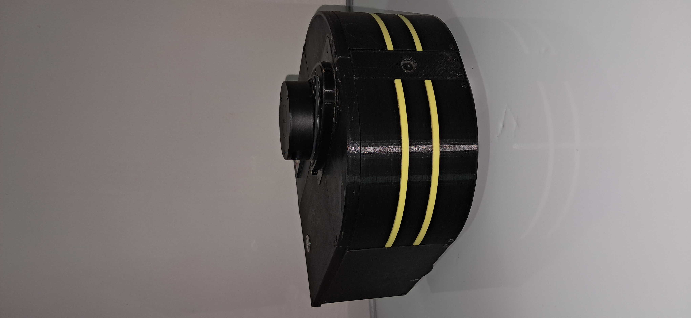
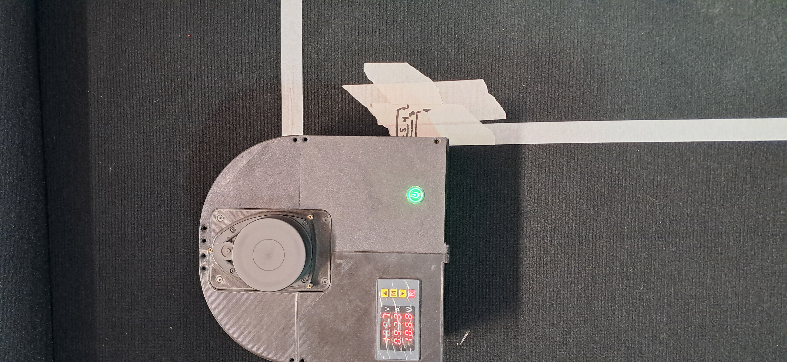
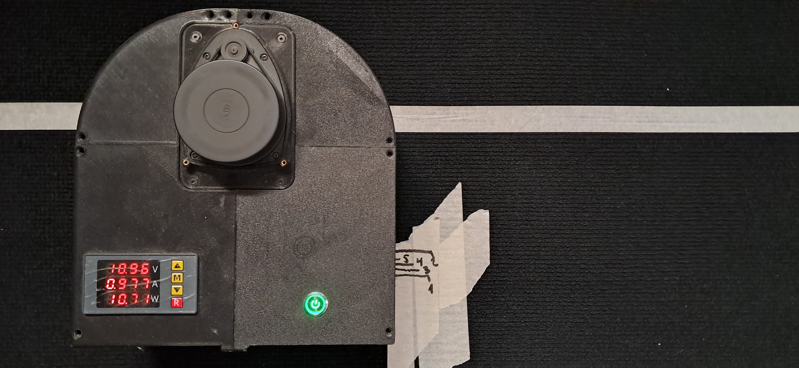
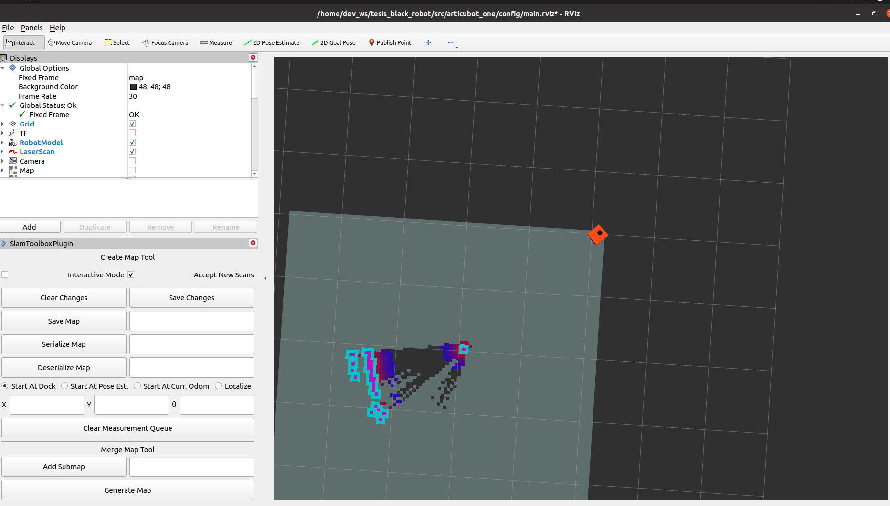
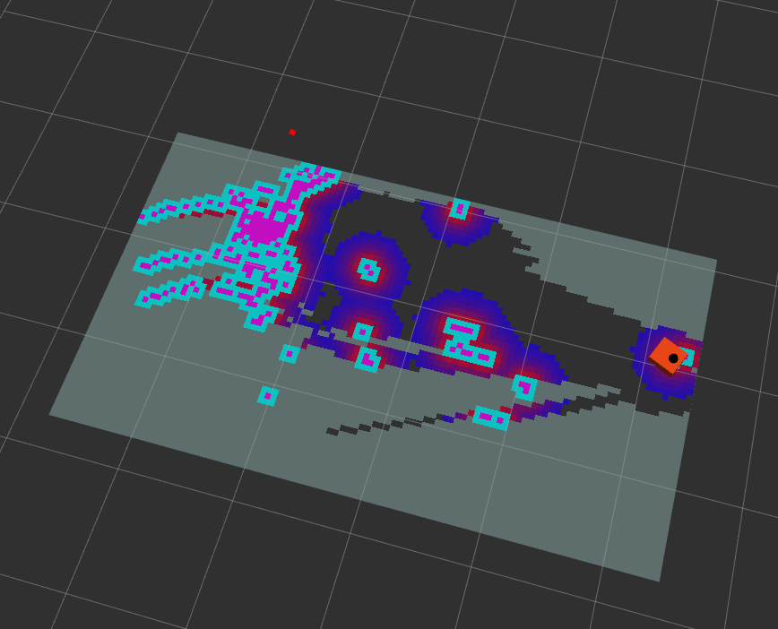
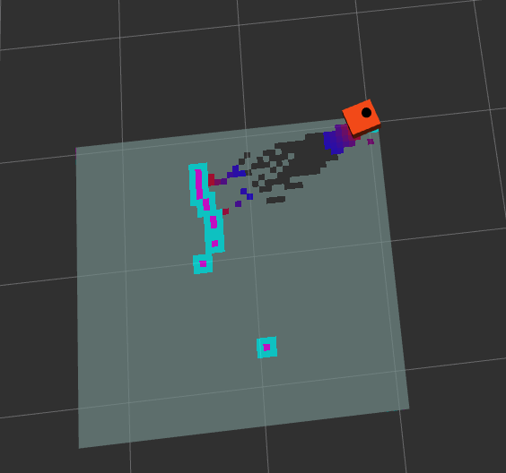
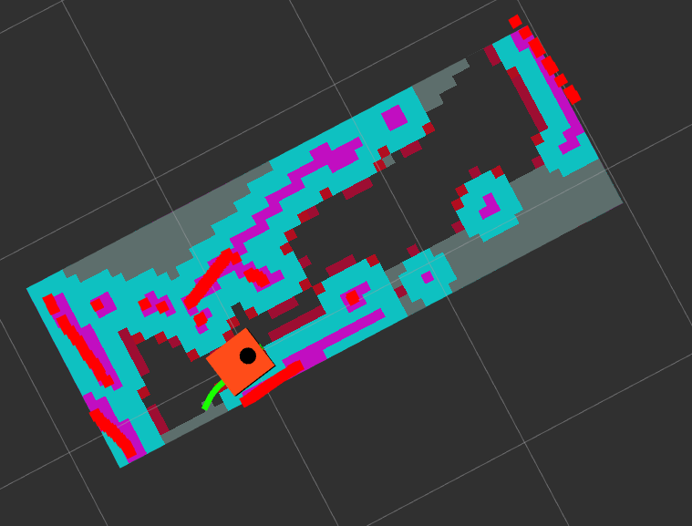
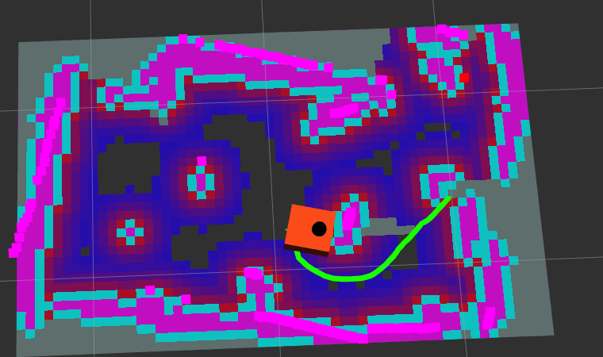

# images

Spanish version: [README.md](README.md)

Photos and screenshots of the project, sorted by topic. Result plots are not here: the scripts generate them, and they stay next to their experiment in `experiments/` and in `firmware/pid_config/`.

## What goes here

- `robot/`: photos of the prototype.
- `field-tests/`: photos of the experiments on the real robot.
- `simulation/`: Gazebo and RViz with the digital twin.
- `real-robot/`: RViz during mapping and navigation on the real robot.

Screenshots of the installation guides stay next to their guide, in `docs/robot-setup/`.

## Naming

kebab-case in English, describing what the image shows. When there are several of the same kind, they end in the date `YYYY-MM-DD` or a number.

## Robot

| | |
| --- | --- |
|  |  |
| Front view, with the camera in the middle and the LIDAR on top. | Diagonal view. |
|  |  |
| Side view. | Top view, with the LIDAR and the voltage, current and power meter. |

## Field tests

Odometry tests on the real robot, on carpet, with tape as reference (March 25, 2026). The results are in `experiments/linea_recta/` and `experiments/prueba_giro/`.

| | |
| --- | --- |
|  |  |
| Robot next to the test marks. | The same position, seen from the other side. |
|  |  |
| Numbered marks of each repetition. | Tape line used as reference. |

## Simulation

| | |
| --- | --- |
|  |  |
| Test world with obstacles in Gazebo Classic. | World layout: 6 m by 8 m, boxes B1 to B8 and cylinders C1 to C6. |
|  |  |
| URDF robot model in RViz. | Points of the simulated LIDAR. |
|  |  |
| Mapping in simulation: RViz on the left and Gazebo on the right. | Start of mapping with the first scans. |
|  |  |
| Costmap during mapping. | Navigation goal set with 2D Goal Pose. |
|  |  |
| Straight path recorded in RViz. | Robot footprint on the costmap. |
|  |  |
| Start of frontier exploration. | Safety zone around the cylinders. |
|  |  |
| Costmap during exploration. | Overview of the explored map. |

## Real robot

| | |
| --- | --- |
|  |  |
| Map of a room with its costmap (January 1, 2026). | Path planned by Nav2 with the LIDAR scans (January 16). |
|  |  |
| Mapping a corridor, capture 1 (January 17). | Capture 2, same day. |
|  |  |
| Capture 3. | Capture 4. |
|  |  |
| Map of a room with two areas marked by hand (January 24). | Navigation path in the same room. |
|  | |
| `ros2 topic hz /odom`: odometry is published at about 30 Hz. | |

The videos of the experiments are in [docs/videos/](../videos/README.en.md).
