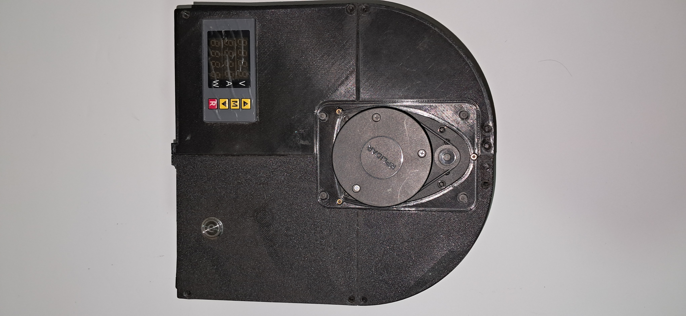
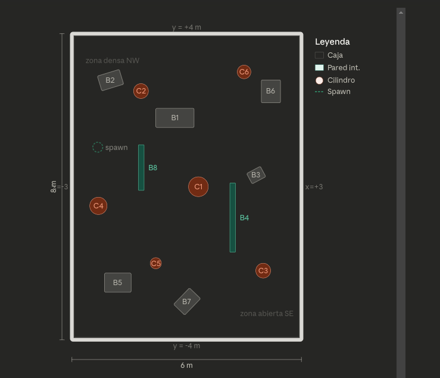
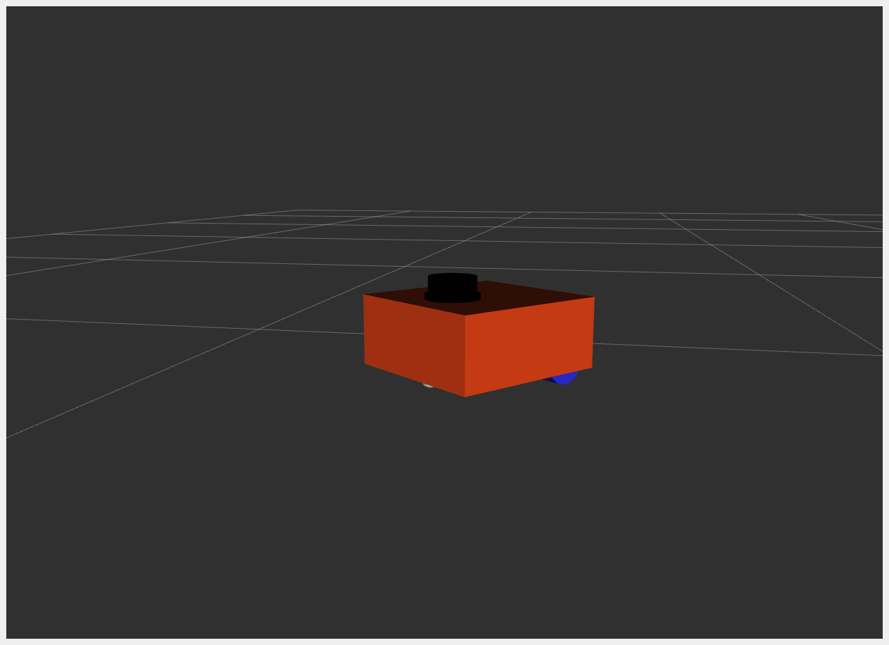
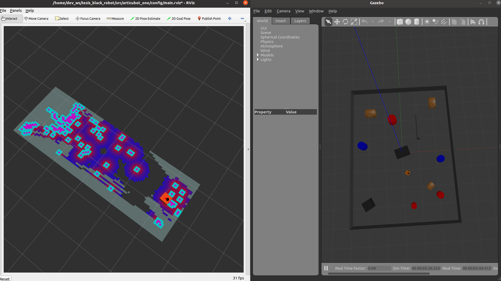
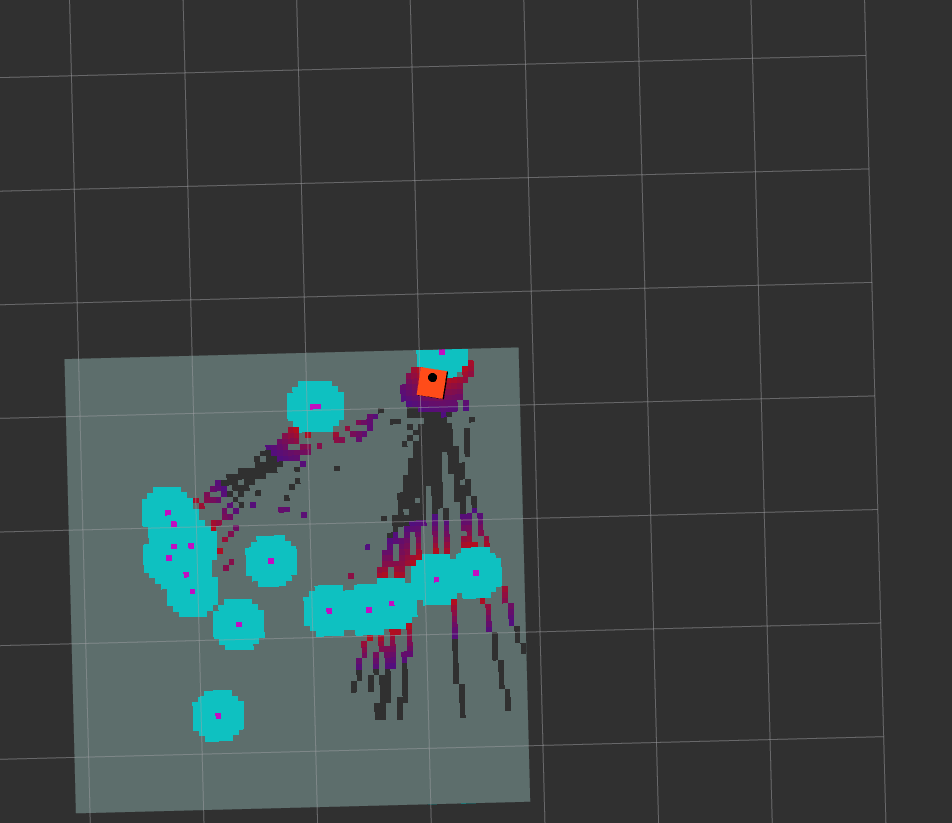
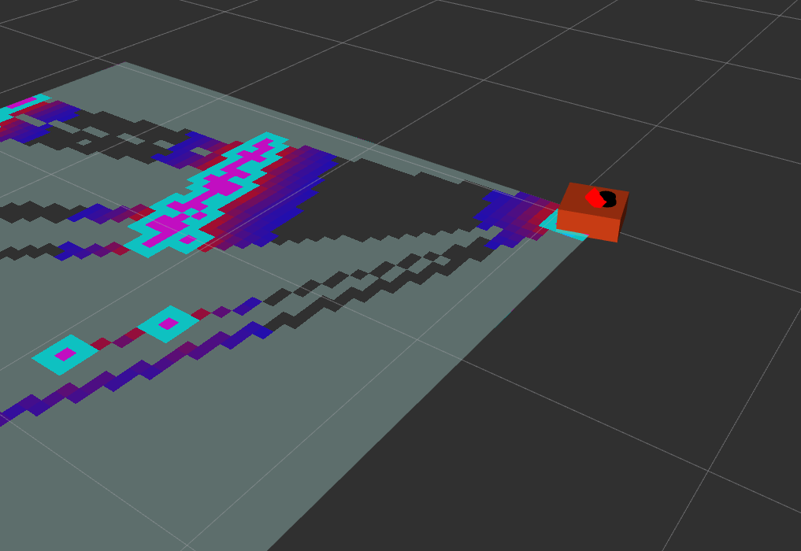
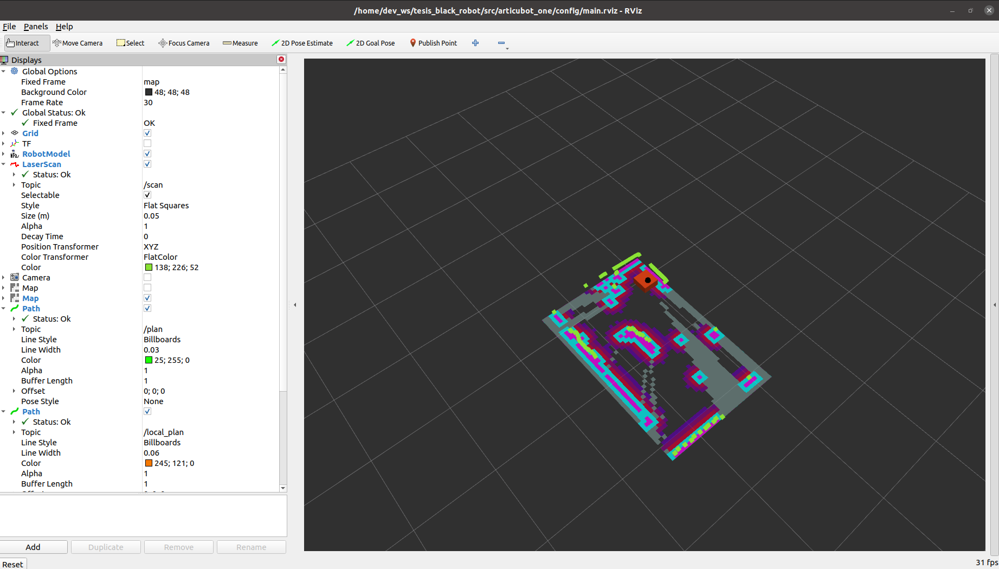
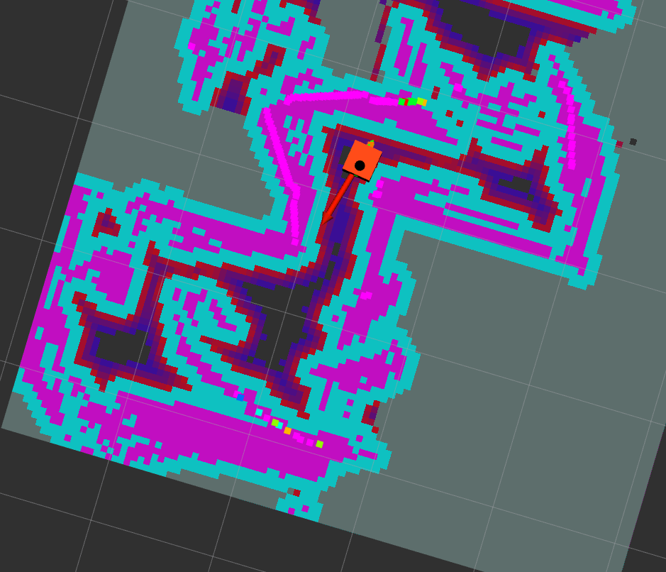
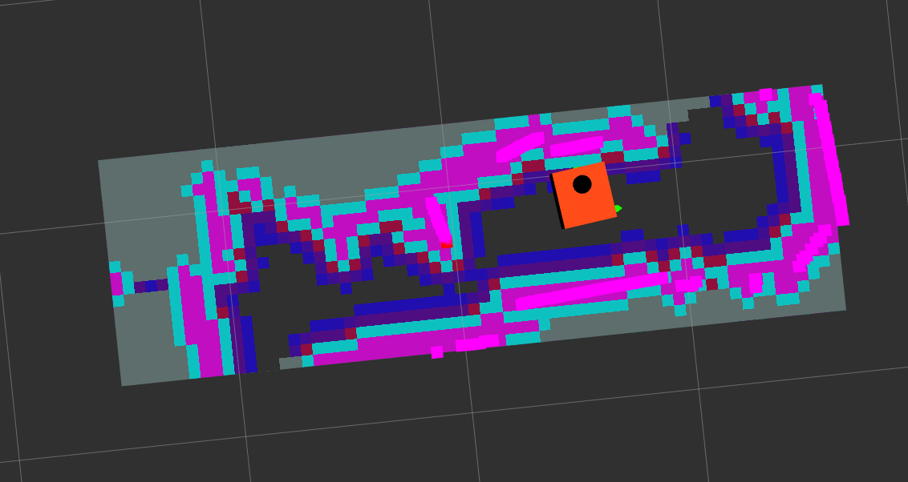
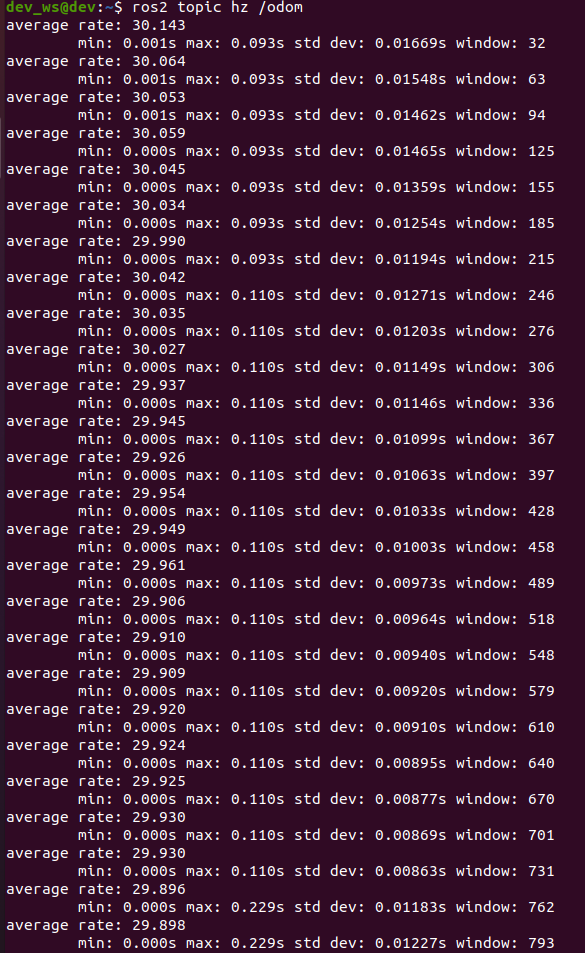

# images

Versión en inglés: [README.en.md](README.en.md)

Fotos y capturas del proyecto, ordenadas por tema. Los gráficos de resultados no están aquí: los generan los scripts y quedan junto a su prueba en `experiments/` y en `firmware/pid_config/`.

## Qué va aquí

- `robot/`: fotos del prototipo.
- `field-tests/`: fotos de las pruebas en el robot real.
- `simulation/`: Gazebo y RViz con el gemelo digital.
- `real-robot/`: RViz durante el mapeo y la navegación del robot real.

Las capturas de las guías de instalación van junto a su guía, en `docs/robot-setup/`.

## Nombres

kebab-case en inglés, describiendo lo que se ve. Si hay varias del mismo tipo, terminan en la fecha `AAAA-MM-DD` o en un número.

## Robot

| | |
| --- | --- |
|  |  |
| Vista frontal, con la cámara al centro y el LIDAR arriba. | Vista diagonal. |
|  |  |
| Vista lateral. | Vista superior, con el LIDAR y el medidor de voltaje, corriente y potencia. |

## Pruebas de campo

Pruebas de odometría en el robot real, sobre alfombra, con cinta como referencia (25 de marzo de 2026). Los resultados están en `experiments/linea_recta/` y `experiments/prueba_giro/`.

| | |
| --- | --- |
|  |  |
| Robot junto a las marcas de la prueba. | La misma posición, vista desde el otro lado. |
|  |  |
| Marcas numeradas de cada repetición. | Línea de cinta usada como referencia. |

## Simulación

| | |
| --- | --- |
|  |  |
| Mundo de prueba con obstáculos en Gazebo Classic. | Plano del mundo: 6 m por 8 m, cajas B1 a B8 y cilindros C1 a C6. |
|  |  |
| Modelo URDF del robot en RViz. | Puntos del LIDAR simulado. |
|  |  |
| Mapeo en simulación: RViz a la izquierda y Gazebo a la derecha. | Inicio del mapeo con los primeros barridos. |
|  |  |
| Mapa de costos durante el mapeo. | Meta de navegación fijada con 2D Goal Pose. |
|  |  |
| Trayectoria recta registrada en RViz. | Huella del robot sobre el mapa de costos. |
|  |  |
| Comienzo de la exploración por fronteras. | Zona de seguridad alrededor de los cilindros. |
|  |  |
| Mapa de costos durante la exploración. | Vista general del mapa explorado. |

## Robot real

| | |
| --- | --- |
|  |  |
| Mapa de una habitación con su mapa de costos (1 de enero de 2026). | Ruta planificada por Nav2 con los barridos del LIDAR (16 de enero). |
|  |  |
| Mapeo de un pasillo, captura 1 (17 de enero). | Captura 2, el mismo día. |
|  |  |
| Captura 3. | Captura 4. |
|  |  |
| Mapa de una sala con dos zonas marcadas a mano (24 de enero). | Ruta de navegación en la misma sala. |
|  | |
| `ros2 topic hz /odom`: la odometría se publica a unos 30 Hz. | |

Los videos de las pruebas están en [docs/videos/](../videos/README.md).
