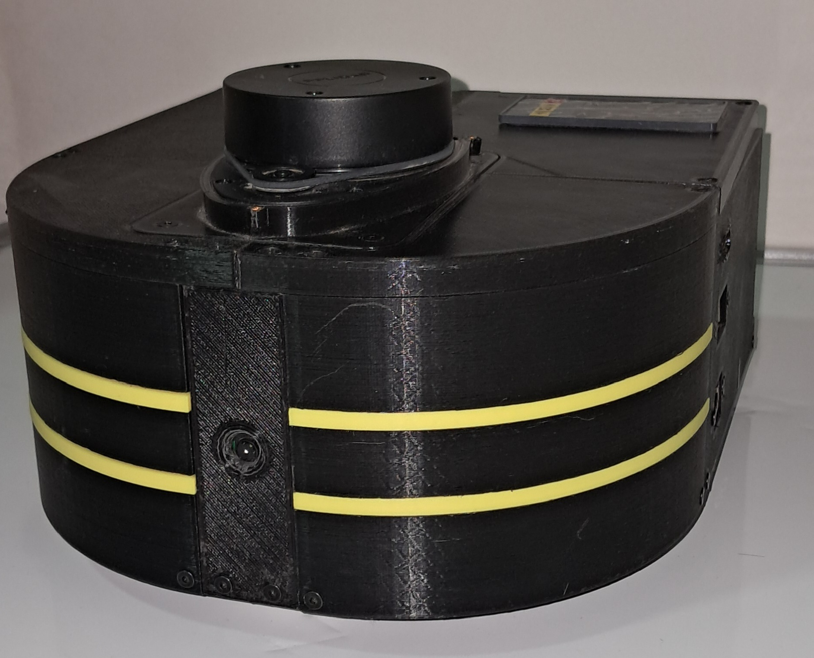
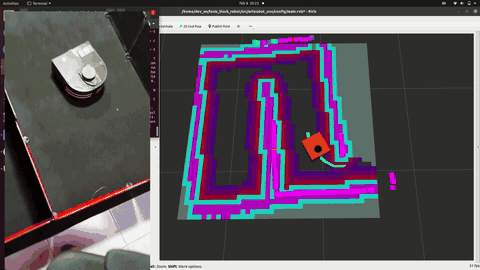
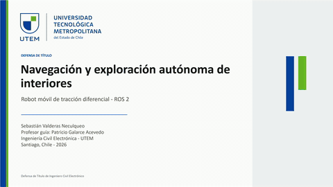
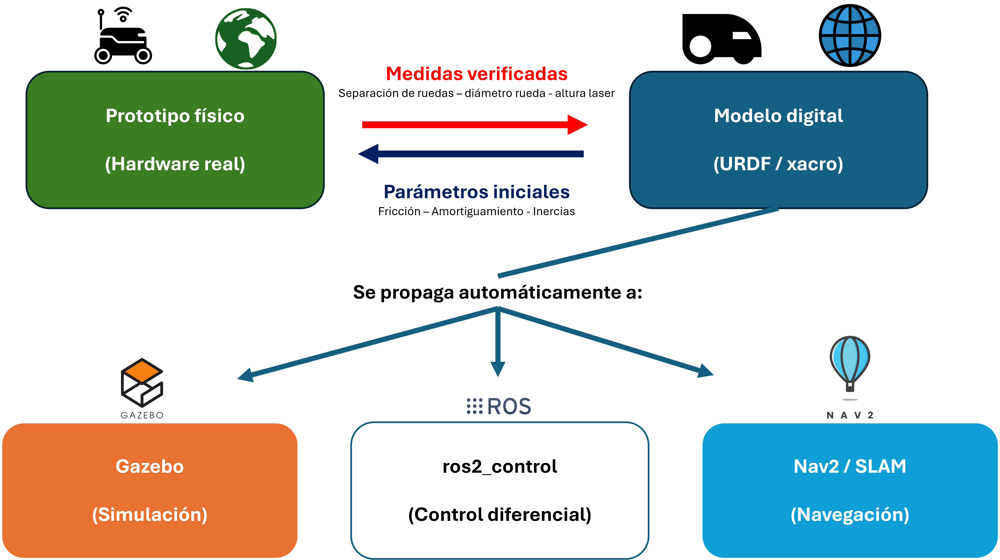
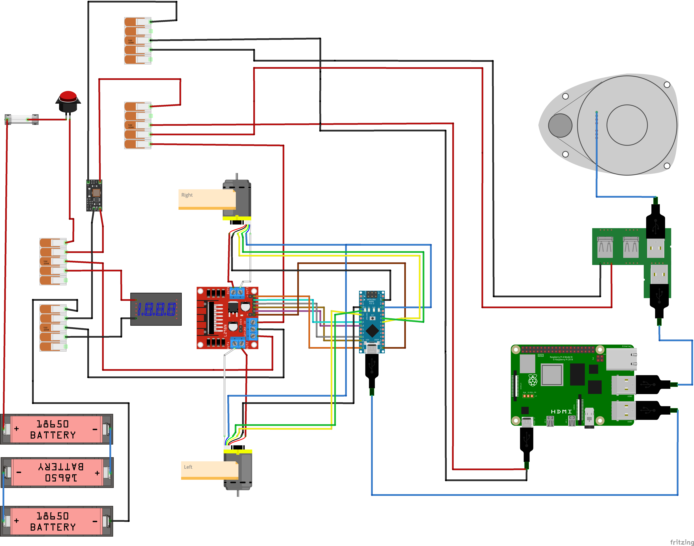
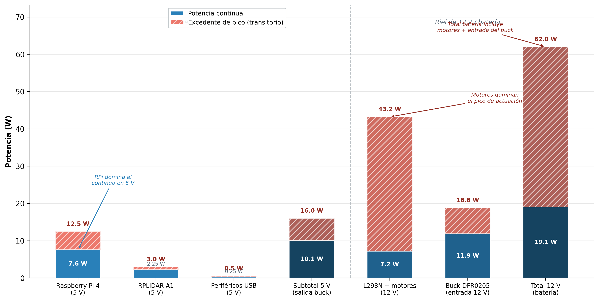
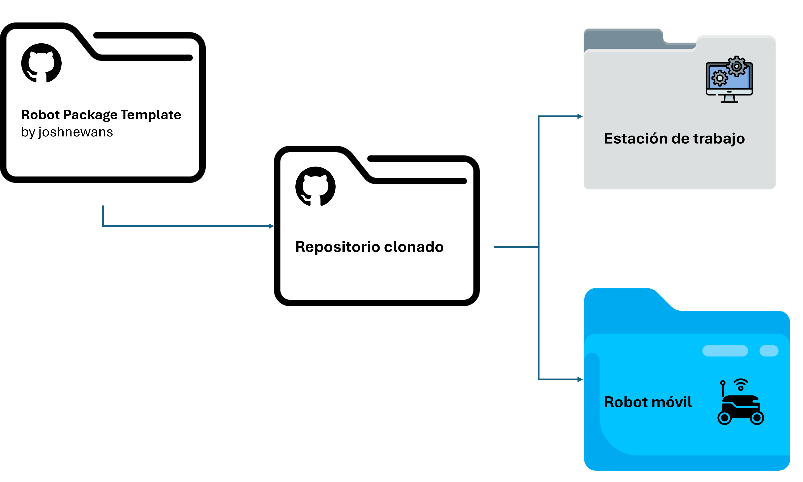

# Autonomous indoor navigation and exploration with a differential drive robot

Spanish version: [README.md](../README.md)

ROS 2 workspace of an Electronic Civil Engineering thesis at Universidad Tecnológica Metropolitana (UTEM, 2026). A low-cost differential drive robot builds a 2D map of a room with SLAM and explores it on its own, heading to frontiers it generates automatically.

**Status:** finished. Code and data match the final version of the thesis.

<p align="center">
  
  <a href="https://github.com/SVN11X/ros2-indoor-exploration-robot/releases/download/demo-videos/2026-02-10-exploration-modular-arena.mp4"></a>
</p>

<p align="center"><em>The prototype and an autonomous exploration in the modular test arena. Click the animation to watch the full video.</em></p>

<p align="center"><a href="https://github.com/SVN11X/ros2-indoor-exploration-robot/releases/download/demo-videos/2026-09-20-thesis-summary.mp4"></a></p>

<p align="center"><em>The thesis in 60 seconds: goals, real and simulated robot, architecture, results and conclusions. Click to watch the video, which is in Spanish.</em></p>

## What it does

- 2D mapping with SLAM Toolbox and an RPLidar A1.
- Autonomous navigation with Nav2.
- Frontier exploration with m-explore, without manual input.
- Digital twin in Gazebo Classic 11 to test everything before the real robot.
- Speed control of each wheel on an Arduino Nano, with gains found by PSO (particle swarm optimization).

Main thesis results: mean odometry error of 3.63 % on straight paths, valid maps in 5 of 6 explorations, and a mean distance of 3.4 cm between the maps and the measured floor plan.

<p align="center"></p>

<p align="center"><em>The digital twin: the URDF and xacro model takes the verified measurements of the real robot (wheel separation and diameter, laser height), and Gazebo, ros2_control and Nav2 with SLAM use that same model.</em></p>

## Hardware

Raspberry Pi 4, Arduino Nano, L298N driver, two DC motors with quadrature encoders, a caster wheel and an RPLidar A1. The chassis and the covers are 3D printed in PLA+.

<p align="center"><a href="../mechanical/README.en.md"></a></p>

<p align="center"><em>1 RPLidar A1, 2 Raspberry Pi Camera v2.1 (not used in the thesis), 3 Arduino Nano, 4 terminal adapter, 5 standoffs and 6 L298N driver. The 3D models of the robot and of each part are in <a href="../mechanical/README.en.md">mechanical/</a>.</em></p>

|  |  |
| --- | --- |
|  |  |
| Power and data connections, drawn in Fritzing. | Continuous and peak power of each part. The motors dominate the peak of the 12 V rail. |

Photos of each part are in [images/](images/README.en.md#parts).

## Software

Ubuntu 20.04 LTS, ROS 2 Foxy and Gazebo Classic 11. The combination was frozen at the start of the project so every package stays compatible.

## Layout

```text
.
├── src/                  ROS 2 packages built by colcon
│   ├── articubot_one/    robot model, launch files and parameters
│   ├── serial_motor_demo/
│   └── third_party/      packages from other projects
├── firmware/             Arduino Nano firmware and PID tuning
├── mechanical/           3D models of the robot and its parts
├── scripts/
│   ├── launch/           start of the robot, the simulation and mapping
│   └── robot-setup/      Raspberry Pi diagnostics and tuning
├── experiments/          thesis experiments and their results
└── docs/                 installation guides, images, costs and documentation
```

The thesis cites paths as they were before this layout, for example `src/test/...`. The mapping table is in [thesis-paths.md](thesis-paths.md).

## Installation

<p align="center"></p>

The repository starts from the robot package template by joshnewans and is cloned twice: on the PC (workstation) and on the robot's Raspberry Pi.

1. Install Ubuntu 20.04 and ROS 2 Foxy with the guides in [robot-setup/](robot-setup/README.md).
2. Install Git LFS before cloning, because the large mapping session files live there:

   ```bash
   sudo apt install git-lfs
   git lfs install
   ```

3. Clone the repository. On the PC it lives in `~/tesis_black_robot` and on the Raspberry Pi in `~/robot_ws`, the paths the scripts use:

   ```bash
   git clone https://github.com/SVN11X/ros2-indoor-exploration-robot.git ~/tesis_black_robot
   ```

4. Build from the workspace root:

   ```bash
   rosdep install --from-paths src --ignore-src -r -y
   colcon build --symlink-install
   source install/setup.bash
   ```

5. Upload `firmware/ROSArduinoBridge/ROSArduinoBridge.ino` to the Arduino Nano with the Arduino IDE.

## Usage

Simulation on the PC:

```bash
bash scripts/launch/launch_sim_all.sh
```

Real robot. First on the Raspberry Pi, then on the PC:

```bash
bash ~/robot_ws/scripts/launch/launch_robot_all.sh
bash ~/tesis_black_robot/scripts/launch/launch_mapeo_all.sh
```

Each thesis experiment lives in `experiments/` with its `run_*.sh` script. The full flow is explained in [how-it-works.md](how-it-works.md).

## Images and videos

- [images/](images/README.en.md): photos of the robot and the experiments, and screenshots of the simulation and the real robot.
- [videos/](videos/README.en.md): the thesis in 60 seconds and previews of 4 demos of the real robot, with a link to each full video.
- [mechanical/](../mechanical/README.en.md): 3D models of the robot and its parts, with images and a 3D viewer on GitHub.
- Result plots stay next to each experiment in [experiments/](../experiments/README.en.md) and in [firmware/](../firmware/README.en.md).

## Documentation

- [goals.md](goals.md): objectives, scope and results.
- [how-it-works.md](how-it-works.md): how it works from start to finish.
- [credits.md](credits.md): origin and license of the third-party packages.
- [thesis-paths.md](thesis-paths.md): thesis paths and their current location.

## Author

Sebastián Valderas Neculqueo. Advisor: Patricio Galarce Acevedo.

## License

The author's own code is released under the MIT license ([LICENSE](../LICENSE)). Third-party packages keep theirs, listed in [credits.md](credits.md).
