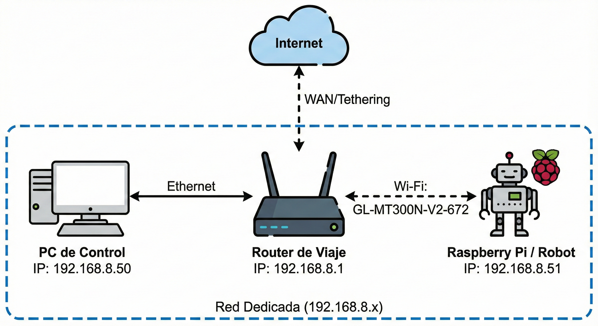
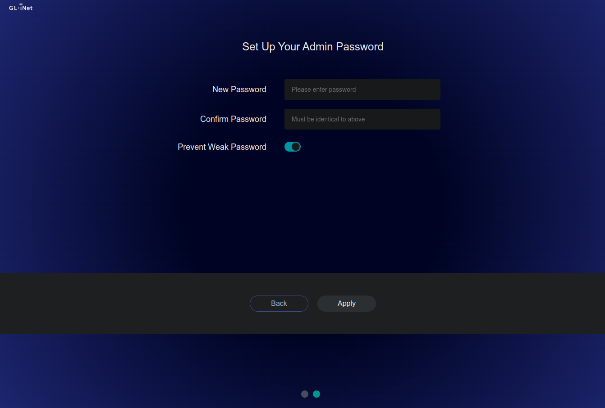
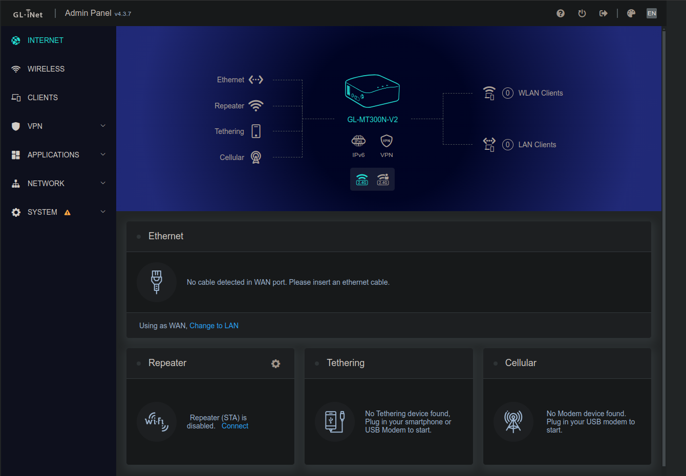
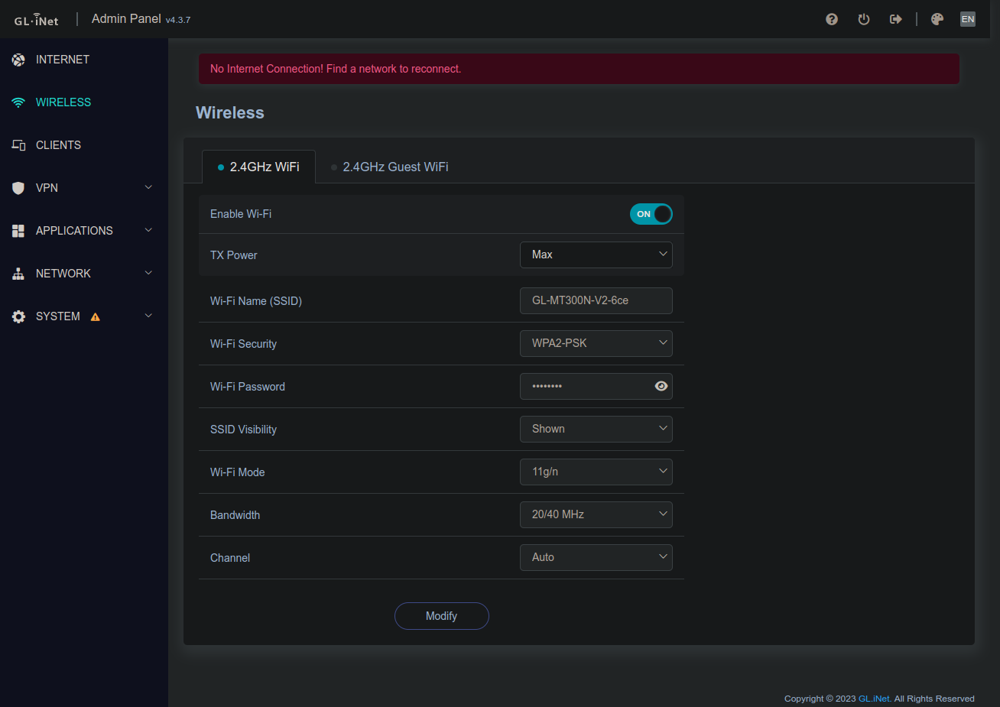
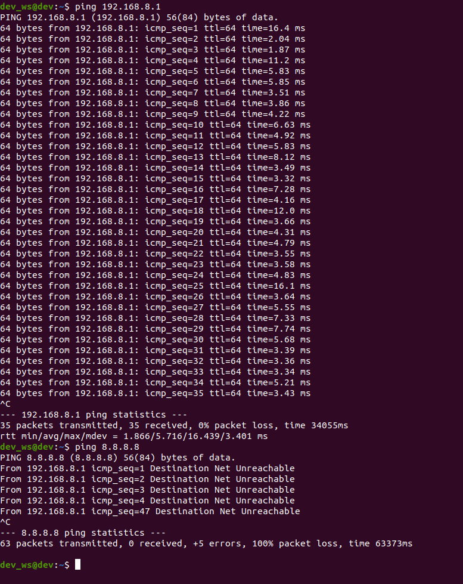
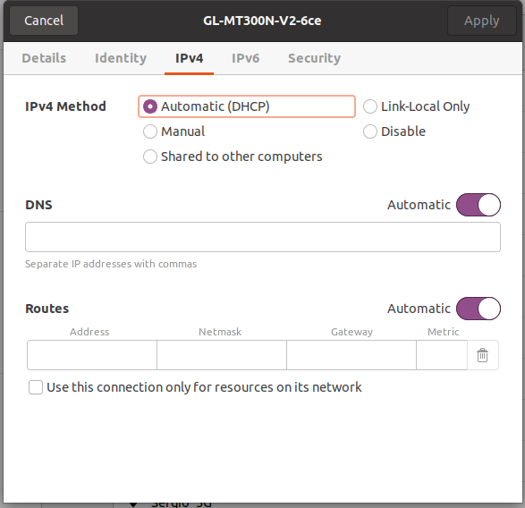
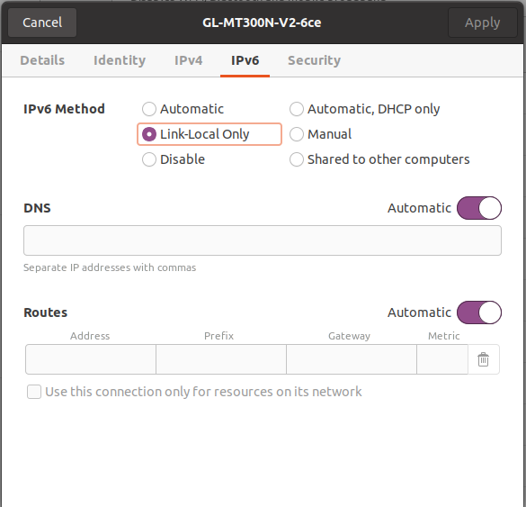

# Network Setup for ROS (Robot Operating System)

Spanish version: [README.md](README.md)

This document describes how to set up a dedicated network between a workstation and a robot, tuned for ROS communication. It uses **Netplan** and a dedicated router to get static IPs and a stable link.

## Network Topology

The following diagram shows the connection layout and the static IP addresses defined for this project:




## Prerequisites

* **Hardware:** Robot computer (e.g. Raspberry Pi), dedicated router (Travel Router) and control computer (PC).
* **Software:** Ubuntu 20.04 (or later).

## 0. Router Setup

The dedicated router is a GL.iNet GL-MT300N-V2. It is set up from its web panel.

| | | |
| --- | --- | --- |
|  |  |  |
| First login: set the admin password. | Dashboard. The WAN port has no cable, so the network has no internet access. | 2.4 GHz Wi-Fi network with WPA2-PSK security. |

## 1. Identify the Network Interfaces

Before configuring, find the logical name of the interfaces on each device.

1.  Open a terminal and run:
    ```bash
    ip addr
    ```
2.  Find the Wi-Fi interface (usually `wlan0`) on the robot and the Ethernet interface (`eth0` or similar) on the PC.

## 2. Static IP with Netplan

Netplan defines the network settings. Below are the specific settings for the Robot and for the PC.

### 2.1. Create the Configuration File

Create a `.yaml` file in the `/etc/netplan/` directory (e.g. `02-my-network-config.yaml`) on both machines:

```bash
sudo pluma /etc/netplan/02-my-network-config.yaml
```

*(Note: You can use `nano` or `vim` if `pluma` is not installed).*

### 2.2. YAML Definition

Copy the block for the device you are configuring. **Important:** Keep the indentation exactly as shown.

#### A. Raspberry Pi Settings (Wi-Fi)
These settings assign the IP `192.168.8.51` to the wireless interface.

```yaml
network:
  version: 2
  renderer: NetworkManager
  wifis:
    wlan0:
      dhcp4: no
      addresses: [192.168.8.51/24]
      gateway4: 192.168.8.1
      nameservers:
        addresses: [192.168.8.1]
      access-points:
        "GL-MT300N-V2-672":
          password: "<WIFI_PASSWORD>"
```

#### B. PC Settings (Ethernet)
These settings assign the IP `192.168.8.50` to the wired interface. (Make sure to replace `eth0` with the real name of your interface if it differs).

```yaml
network:
  version: 2
  renderer: NetworkManager
  ethernets:
    eth0:
      dhcp4: no
      addresses: [192.168.8.50/24]
      gateway4: 192.168.8.1
      nameservers:
        addresses: [192.168.8.1]
```

### 2.3. Apply the Changes

To apply the settings, run the following commands in the terminal of each device:

```bash
sudo netplan generate
sudo netplan apply
```

### 2.4. Verification

From the PC, the router must answer:



`ping 192.168.8.1` answers with no loss. `ping 8.8.8.8` fails because the network has no internet access, which is expected.

### 2.5. Alternative: PC over Wi-Fi

The PC can also join the router network over Wi-Fi from the Ubuntu graphical settings:

| | |
| --- | --- |
|  |  |
| IPv4 automatic (DHCP). | IPv6 link-local only. |

## 3. Remote Access (SSH)

For *headless* administration (no monitor), install the SSH server on the robot.

### 3.1. Installation (On the Robot)

```bash
sudo apt install openssh-server
```

### 3.2. Connection (From the PC)

From the PC (which now has the IP `192.168.8.50`), connect to the robot:

```bash
ssh robot@192.168.8.51
```

## 4. Notes about ROS

* **ROS 2:** Since both devices are on the same subnet (`192.168.8.x`) and connected to the same dedicated router, node discovery is automatic and needs no extra environment variables such as `ROS_MASTER_URI`.
