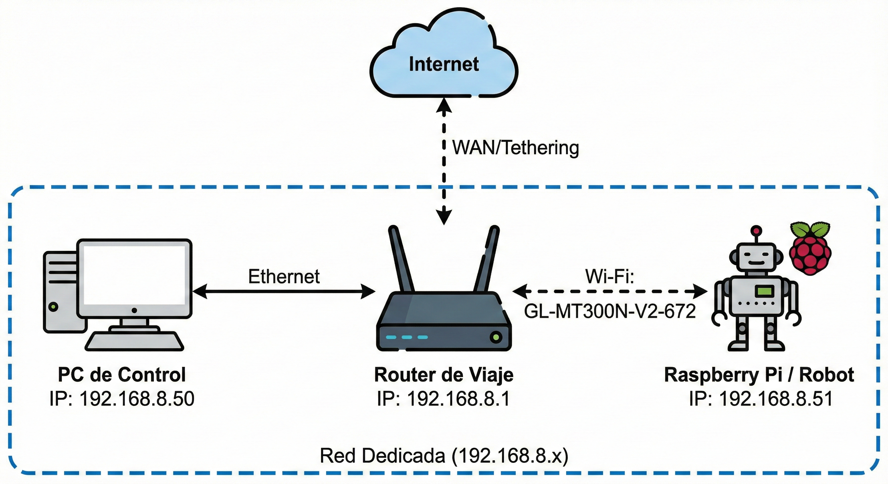

# Configuración de Red para ROS (Robot Operating System)

Versión en inglés: [README.en.md](README.en.md)

Este documento describe el procedimiento técnico para configurar una red dedicada entre una estación de trabajo y un robot, optimizando la comunicación para entornos ROS. El procedimiento se basa en el uso de **Netplan** y un router dedicado para garantizar IPs estáticas y estabilidad.

## Topología de Red

El siguiente diagrama ilustra la arquitectura de conexión y las direcciones IP estáticas definidas para este proyecto:




## Requisitos Previos

* **Hardware:** Ordenador del robot (ej. Raspberry Pi), Router dedicado (Travel Router) y Ordenador de control (PC).
* **Software:** Ubuntu 20.04 (o superior).

## 1. Identificación de Interfaces de Red

Antes de la configuración, identifique el nombre lógico de las interfaces en cada dispositivo.

1.  Abra una terminal y ejecute:
    ```bash
    ip addr
    ```
2.  Localice la interfaz Wi-Fi (comúnmente `wlan0`) en el robot y la interfaz Ethernet (`eth0` o similar) en el PC.

## 2. Configuración de IP Estática con Netplan

Se utiliza Netplan para definir la configuración de red. A continuación se presentan las configuraciones específicas para el Robot y para el PC.

### 2.1. Creación del Archivo de Configuración

Cree un archivo `.yaml` en el directorio `/etc/netplan/` (ej. `02-my-network-config.yaml`) en ambos equipos:

```bash
sudo pluma /etc/netplan/02-my-network-config.yaml
```

*(Nota: Puede usar `nano` o `vim` si no tiene `pluma` instalado).*

### 2.2. Definición del YAML

Copie el bloque correspondiente según el dispositivo que esté configurando. **Importante:** Respete la indentación estrictamente.

#### A. Configuración para Raspberry Pi (Wi-Fi)
Esta configuración asigna la IP `192.168.8.51` a la interfaz inalámbrica.

```yaml
network:
  version: 2
  renderer: NetworkManager
  wifis:
    wlan0:
      dhcp4: no
      addresses: [192.168.8.51/24]
      gateway4: 192.168.8.1
      nameservers:
        addresses: [192.168.8.1]
      access-points:
        "GL-MT300N-V2-672":
          password: "<WIFI_PASSWORD>"
```

#### B. Configuración para PC (Ethernet)
Esta configuración asigna la IP `192.168.8.50` a la interfaz cableada. (Asegúrese de cambiar `eth0` por el nombre real de su interfaz si es diferente).

```yaml
network:
  version: 2
  renderer: NetworkManager
  ethernets:
    eth0:
      dhcp4: no
      addresses: [192.168.8.50/24]
      gateway4: 192.168.8.1
      nameservers:
        addresses: [192.168.8.1]
```

### 2.3. Aplicación de Cambios

Para que la configuración surta efecto, ejecute los siguientes comandos en la terminal de cada dispositivo:

```bash
sudo netplan generate
sudo netplan apply
```

## 3. Configuración de Acceso Remoto (SSH)

Para administración *headless* (sin monitor), instale el servidor SSH en el robot.

### 3.1. Instalación (En el Robot)

```bash
sudo apt install openssh-server
```

### 3.2. Conexión (Desde el PC)

Desde el PC (que ahora tiene la IP `192.168.8.50`), conéctese al robot:

```bash
ssh robot@192.168.8.51
```

## 4. Notas sobre ROS

* **ROS 2:** Al estar ambos dispositivos en la misma subred (`192.168.8.x`) y conectados al mismo router dedicado, el descubrimiento de nodos es automático y no requiere configuración adicional de variables de entorno como `ROS_MASTER_URI`.