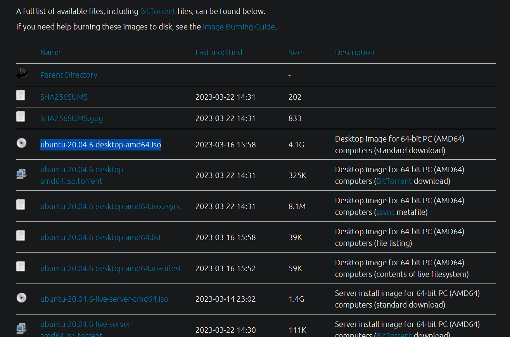
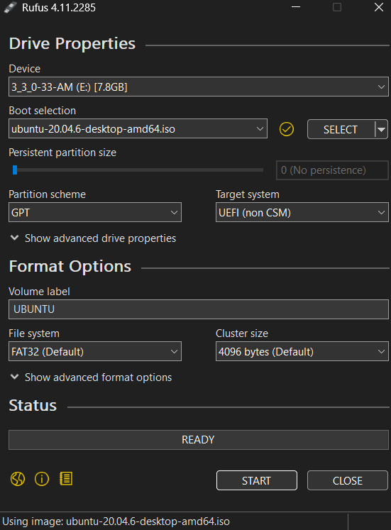

# Ubuntu 20.04 LTS Installation

Spanish version: [README.md](README.md)

This section describes how the installation media was created and how the operating system was configured.

## 1. Software Requirements and Resources

The procedure requires the following downloads:

* **Ubuntu 20.04 ISO image:**
  [https://releases.ubuntu.com/focal/ubuntu-20.04.6-desktop-amd64.iso](https://releases.ubuntu.com/focal/ubuntu-20.04.6-desktop-amd64.iso)
  
* **Media creation tool (Rufus):**
  [https://rufus.ie/en/](https://rufus.ie/en/)

---

## 2. Installation Media Setup (Rufus)

A USB drive larger than 4 GB was connected. Rufus was then run with the settings shown in the attached screenshot:

**Settings applied:**

1.  **Boot selection:** The disk image `ubuntu-20.04.6-desktop-amd64.iso` was loaded in its field.
2.  **Partition scheme:** **GPT** was selected, the standard required for modern systems.
3.  **Target system:** It was set automatically to **UEFI (non CSM)**.
4.  **Volume label:** The drive was named **UBUNTU** so it is easy to recognize.
5.  **File system:** The default **FAT32** format was kept.

After checking the settings, the process was started with the **START** button, choosing the "ISO Image" write mode and confirming the format of the external drive.

---

## 3. System Startup (Boot)

1.  The computer was restarted with the USB drive connected.
2.  During startup, the *Boot Menu* was opened with the function key of the hardware manufacturer.
3.  The USB drive marked with the **UEFI** prefix was selected as the main boot device.

## 4. Operating System Installation

Once the installer loaded, the following settings were applied:

1.  **Language:** Spanish was selected, followed by "Install Ubuntu".
2.  **Keyboard layout:** The layout was set to "Spanish (Latin American)".
3.  **Software and updates:** "Normal installation" was chosen, with the box to download third-party software (graphics and network drivers) checked.
4.  **Installation type:**
    * For a clean install, choose **"Erase disk and install Ubuntu"**.
    * To keep both systems, choose **"Install Ubuntu alongside Windows"**.
5.  **Credentials:** The username and the administrator password were set.

When the files finished copying, the system asked to remove the installation media and restart the computer to complete the procedure.
