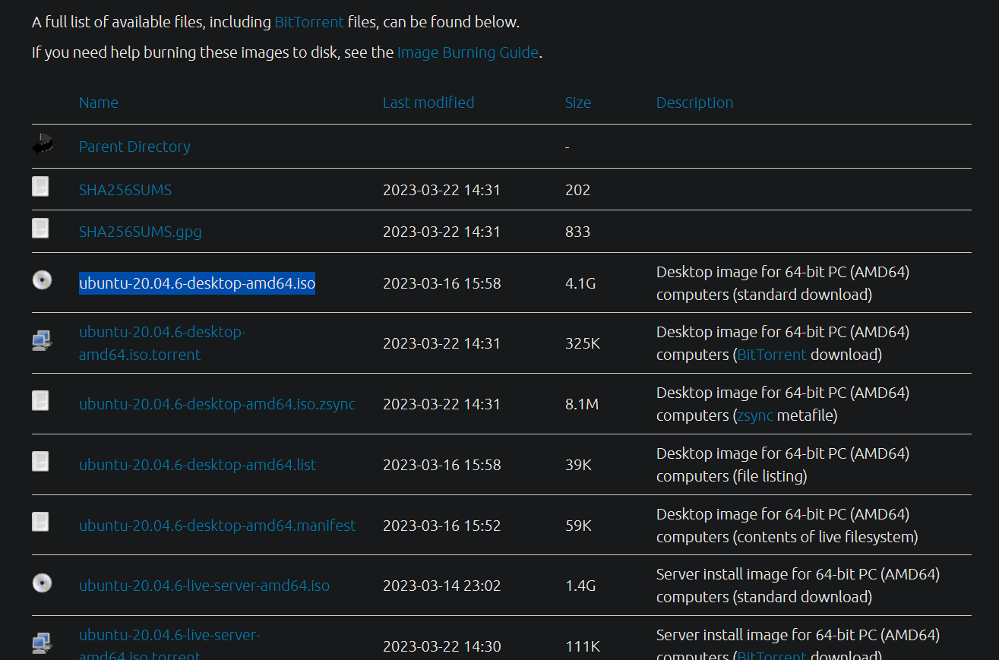
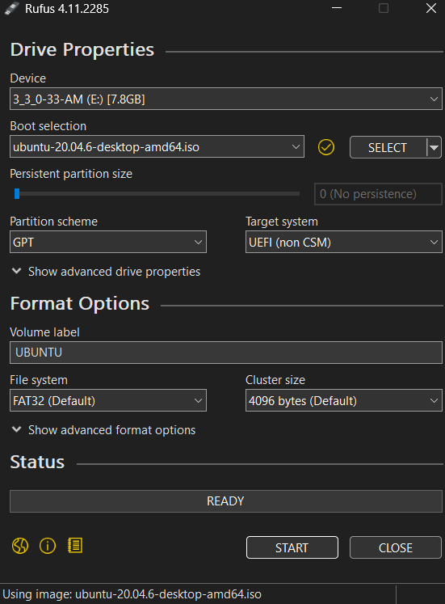

# Instalación de Ubuntu 20.04 LTS

Versión en inglés: [README.en.md](README.en.md)

A continuación se detalla el proceso técnico para la creación del medio de instalación y la configuración del sistema operativo.

## 1. Requisitos y Recursos de Software

Para la ejecución del procedimiento, se requiere la obtención de los siguientes recursos digitales:

* **Imagen ISO de Ubuntu 20.04:**
  [https://releases.ubuntu.com/focal/ubuntu-20.04.6-desktop-amd64.iso](https://releases.ubuntu.com/focal/ubuntu-20.04.6-desktop-amd64.iso)
  
* **Herramienta de creación de medios (Rufus):**
  [https://rufus.ie/en/](https://rufus.ie/en/)

---

## 2. Configuración del Medio de Instalación (Rufus)

Se procedió a conectar una unidad de almacenamiento USB con capacidad superior a 4 GB. Posteriormente, se ejecutó el software Rufus y se establecieron los parámetros de configuración según se muestra en la evidencia adjunta:

**Detalle de la configuración aplicada:**

1.  **Selección de arranque:** Se cargó la imagen de disco `ubuntu-20.04.6-desktop-amd64.iso` en el campo correspondiente.
2.  **Esquema de partición:** Se seleccionó la opción **GPT**, estándar requerido para compatibilidad con sistemas modernos.
3.  **Sistema de destino:** La configuración se estableció automáticamente en **UEFI (non CSM)**.
4.  **Etiqueta del volumen:** Se asignó el identificador **UBUNTU** a la unidad para facilitar su reconocimiento.
5.  **Sistema de archivos:** Se mantuvo el formato **FAT32** por defecto.

Tras la verificación de los parámetros, se inició el proceso mediante el botón **EMPEZAR**, seleccionando el modo de escritura "Imagen ISO" y confirmando el formateo de la unidad externa.

---

## 3. Inicialización del Sistema (Arranque)

1.  Se reinició el equipo con la unidad USB conectada.
2.  Durante la secuencia de inicio, se accedió al menú de arranque (*Boot Menu*) mediante la tecla de función correspondiente al fabricante del hardware.
3.  Se seleccionó la unidad USB identificada con el prefijo **UEFI** como dispositivo de arranque principal.

## 4. Proceso de Instalación del Sistema Operativo

Una vez cargado el entorno de instalación, se ejecutaron las siguientes configuraciones:

1.  **Idioma:** Se seleccionó el idioma Español y se procedió con la opción "Instalar Ubuntu".
2.  **Disposición del teclado:** Se configuró el mapa de caracteres como "Spanish (Latin American)".
3.  **Software y actualizaciones:** Se optó por la "Instalación normal", activando la casilla para la descarga de software de terceros (controladores gráficos y de red).
4.  **Tipo de instalación:**
    * Para una instalación limpia, se selecciona **"Borrar disco e instalar Ubuntu"**.
    * Para la coexistencia de sistemas, se selecciona **"Instalar Ubuntu junto a Windows"**.
5.  **Credenciales:** Se definieron el nombre de usuario y la contraseña de administrador.

Al finalizar la copia de archivos, el sistema solicitó la extracción del medio de instalación y el reinicio del equipo para completar el procedimiento.