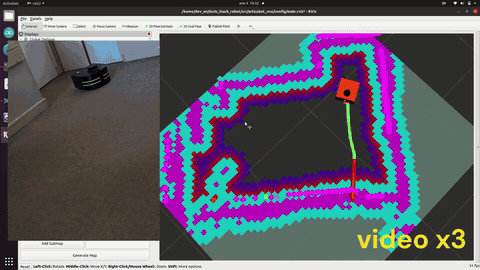
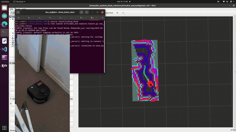
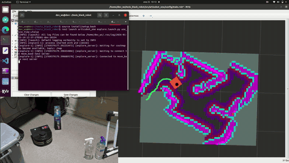
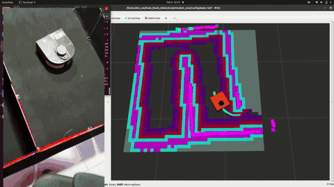

# videos

Spanish version: [README.md](README.md)

Videos of the real robot. The full videos weigh between 119 and 642 MB, so they live in the [Demo videos](https://github.com/SVN11X/ros2-indoor-exploration-robot/releases/tag/demo-videos) release and not in git. This folder keeps a 12 second preview of each one. Every video shows a phone camera next to RViz.

## What goes here

- GIF previews under 5 MB, with the same name as the full video in the release.
- Full videos go as files of a GitHub release, never in git.

## Naming

`YYYY-MM-DD-what-it-shows.gif`, with the recording date.

## Demos

| Preview | What it shows |
| --- | --- |
|  | **January 5, 2026.** Mapping a room and navigating to goals set in RViz. [Full video (4 min 38 s)](https://github.com/SVN11X/ros2-indoor-exploration-robot/releases/download/demo-videos/2026-01-05-mapping-and-navigation-apartment.mp4) |
|  | **January 18, 2026.** Autonomous frontier exploration of a hallway. [Full video (51 s)](https://github.com/SVN11X/ros2-indoor-exploration-robot/releases/download/demo-videos/2026-01-18-exploration-hallway.mp4) |
|  | **January 27, 2026.** Autonomous exploration of a larger room. [Full video (1 min 29 s)](https://github.com/SVN11X/ros2-indoor-exploration-robot/releases/download/demo-videos/2026-01-27-exploration-room.mp4) |
|  | **February 10, 2026.** Autonomous exploration of the modular test arena built for the thesis. [Full video (1 min 10 s)](https://github.com/SVN11X/ros2-indoor-exploration-robot/releases/download/demo-videos/2026-02-10-exploration-modular-arena.mp4) |

Photos and screenshots of the project are in [docs/images/](../images/README.en.md).
