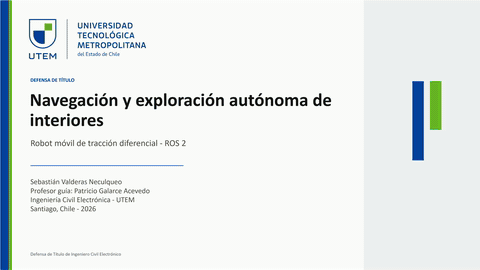
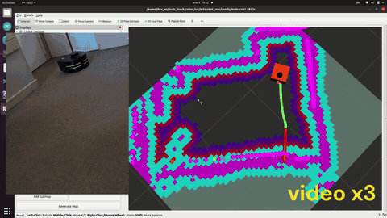
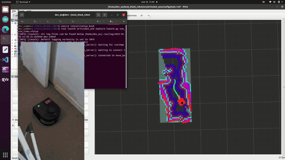
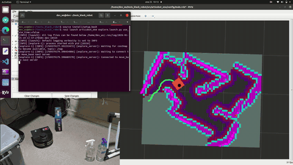
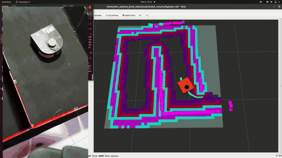

# videos

Versión en inglés: [README.en.md](README.en.md)

El resumen de la tesis y videos del robot real. Los videos completos pesan entre 55 y 642 MB, así que están en el release [Demo videos](https://github.com/SVN11X/ros2-indoor-exploration-robot/releases/tag/demo-videos) y no en git. Aquí queda una vista previa de 12 segundos de cada uno.

## Resumen de la tesis

| Vista previa | Qué muestra |
| --- | --- |
|  | La tesis en 60 segundos: objetivos, robot real y simulado, arquitectura, resultados en la arena modular y conclusiones. La vista previa lo muestra completo a 5 veces su velocidad. [Video completo (1 min, 4K)](https://github.com/SVN11X/ros2-indoor-exploration-robot/releases/download/demo-videos/2026-09-20-thesis-summary.mp4) |

## Qué va aquí

- Vistas previas GIF de menos de 5 MB, con el mismo nombre que el video completo del release.
- Los videos completos van como archivos de un release de GitHub, nunca en git.

## Nombres

`AAAA-MM-DD-que-muestra.gif`, con la fecha de la grabación.

## Demos

Cada demo muestra la cámara de un teléfono junto a RViz.

| Vista previa | Qué muestra |
| --- | --- |
|  | **5 de enero de 2026.** Mapeo de una habitación y navegación hacia metas fijadas en RViz. [Video completo (4 min 38 s)](https://github.com/SVN11X/ros2-indoor-exploration-robot/releases/download/demo-videos/2026-01-05-mapping-and-navigation-apartment.mp4) |
|  | **18 de enero de 2026.** Exploración autónoma por fronteras de un pasillo. [Video completo (51 s)](https://github.com/SVN11X/ros2-indoor-exploration-robot/releases/download/demo-videos/2026-01-18-exploration-hallway.mp4) |
|  | **27 de enero de 2026.** Exploración autónoma de una sala más grande. [Video completo (1 min 29 s)](https://github.com/SVN11X/ros2-indoor-exploration-robot/releases/download/demo-videos/2026-01-27-exploration-room.mp4) |
|  | **10 de febrero de 2026.** Exploración autónoma de la arena modular de pruebas construida para la tesis. [Video completo (1 min 10 s)](https://github.com/SVN11X/ros2-indoor-exploration-robot/releases/download/demo-videos/2026-02-10-exploration-modular-arena.mp4) |

Las fotos y capturas del proyecto están en [docs/images/](../images/README.md).
