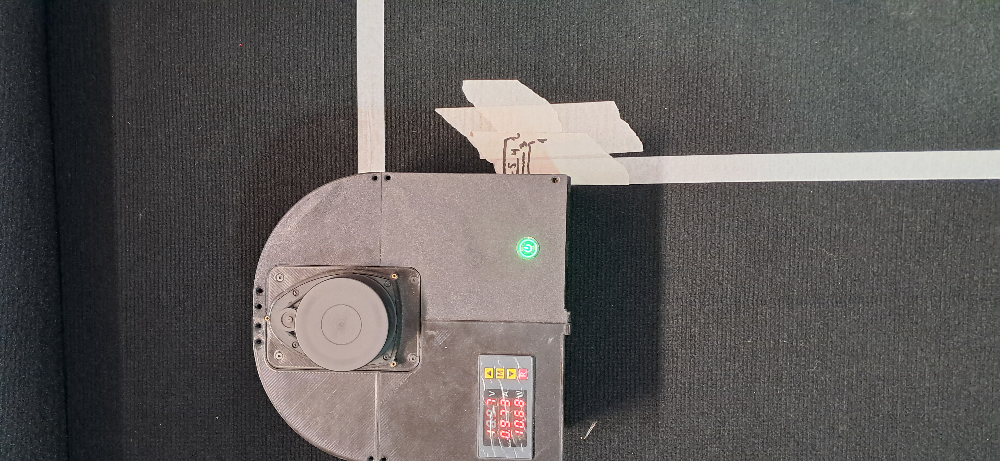
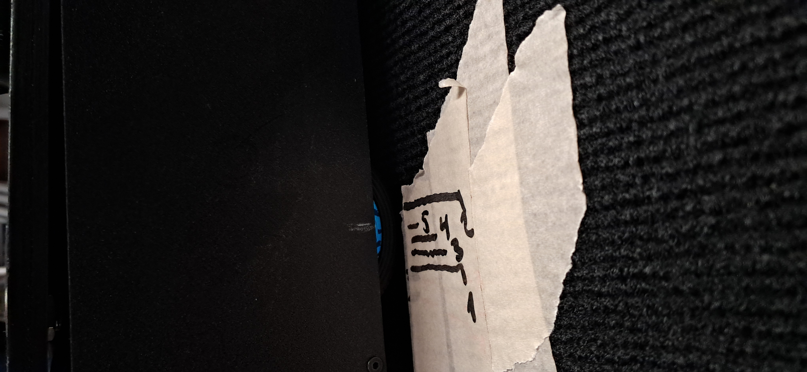
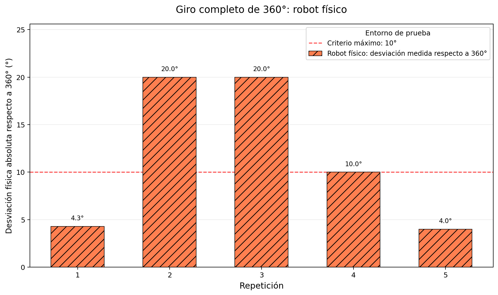
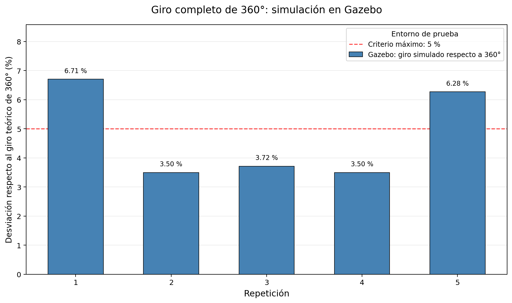
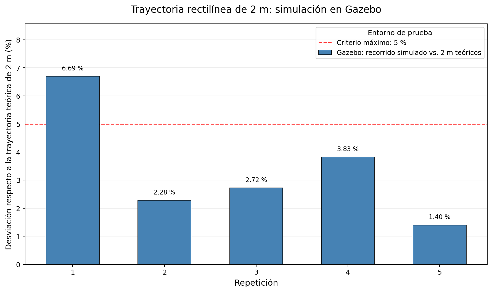
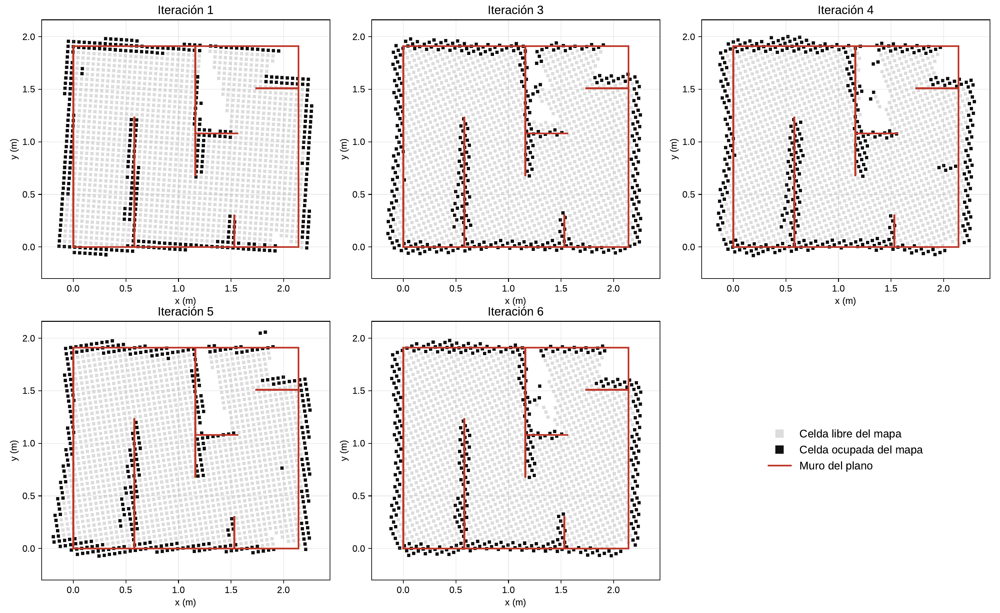
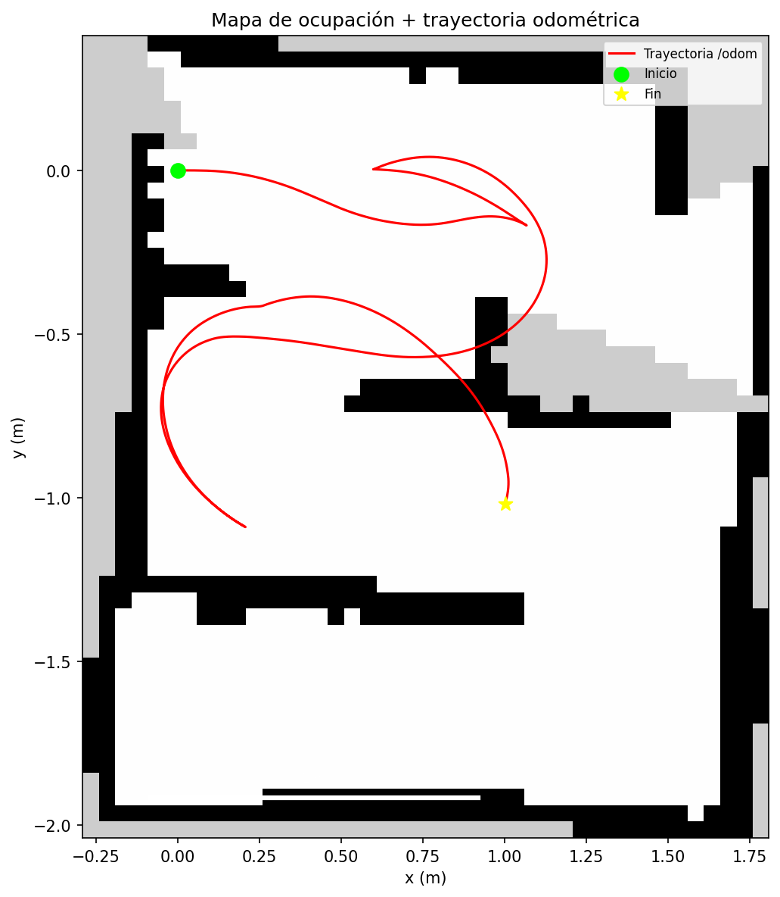

# experiments

Versión en inglés: [README.en.md](README.en.md)

Pruebas de campo y de simulación de la tesis, con sus scripts y sus resultados registrados.

## Qué va aquí

- Una carpeta por prueba, por ejemplo `prueba_giro/` (robot real) y `prueba_giro_sim/` (Gazebo).
- En cada carpeta, el script que ejecuta la prueba (`run_*.sh`), el que la analiza (`analizar_*.py`) y los resultados que cita la tesis.
- `sesiones_mapeo/`: copias de cada sesión de mapeo y exploración. Los archivos `.posegraph` y `*_slam_replay.log` están en Git LFS.
- `utils/`, `recursos/` y `check/`: herramientas que comparten varias pruebas.
- `requirements.txt` y `setup_test_env.sh`: dependencias de Python de los análisis.

## Qué no va aquí

- Paquetes de ROS 2 (van en `src/`).
- Scripts para lanzar el robot o la simulación (van en `scripts/launch/`).
- Pruebas automáticas que corren sin robot ni Gazebo (irían en `tests/`).

## Nombres

Carpetas en snake_case y en español, como las cita la tesis. El sufijo `_sim` indica la versión en simulación de una prueba.

## Uso

Desde la raíz del workspace, después de `colcon build` y con el robot o la simulación en marcha:

```bash
bash experiments/prueba_giro/run_prueba_giro.sh
```

## Resultados

Gráficos que generan los scripts de cada prueba. Cada script guarda su gráfico con el nombre que aparece aquí, así que no se renombran.

### Odometría

| | |
| --- | --- |
|  |  |
| Robot real junto a las marcas de la prueba. | Marcas numeradas de cada repetición. |
|  |  |
| Giro de 360° en el robot real: desviación de cada repetición, con criterio máximo de 10°. `prueba_giro/` | Giro de 360° en Gazebo: desviación de cada repetición, con criterio máximo de 5 %. `prueba_giro_sim/` |
|  | |
| Trayectoria recta de 2 m en Gazebo: desviación de cada repetición, con criterio máximo de 5 %. `linea_recta_sim/` | El resultado de la trayectoria recta en el robot real solo está en PDF: [linea_recta/odom_error_barras.pdf](linea_recta/odom_error_barras.pdf). |

### Mapeo y exploración

| | |
| --- | --- |
|  |  |
| Mapas de las iteraciones 1, 3, 4, 5 y 6 alineados con el plano medido del recinto. `mapas_vs_plano/` | Mapa de la iteración 1 con la trayectoria de la odometría. `slam/analizar_slam.py` |

Mapa y trayectoria de las demás iteraciones: [3](sesiones_mapeo/sesion_actual/iteracion_03/analisis_post/slam_mapa_vis_iter03.png) (mapa, [trayectoria](sesiones_mapeo/sesion_actual/iteracion_03/analisis_post/slam_trayectoria_iter03.png)), [4](sesiones_mapeo/sesion_actual/iteracion_04/analisis_post/slam_mapa_vis_iter04.png) (mapa, [trayectoria](sesiones_mapeo/sesion_actual/iteracion_04/analisis_post/slam_trayectoria_iter04.png)), [5](sesiones_mapeo/sesion_actual/iteracion_05/analisis_post/slam_mapa_vis_iter05.png) (mapa, [trayectoria](sesiones_mapeo/sesion_actual/iteracion_05/analisis_post/slam_trayectoria_iter05.png)), [6](sesiones_mapeo/sesion_actual/iteracion_06/analisis_post/slam_mapa_vis_iter06.png) (mapa, [trayectoria](sesiones_mapeo/sesion_actual/iteracion_06/analisis_post/slam_trayectoria_iter06.png)). La iteración 2 no tiene mapa válido.

Fotos de las pruebas en [docs/images/](../docs/images/README.md) y videos en [docs/videos/](../docs/videos/README.md).

La tesis cita estas rutas como `src/test/...`. La tabla de equivalencias está en `docs/thesis-paths.md`.
