# firmware

Spanish version: [README.md](README.md)

Code that runs on the Arduino Nano, and the scripts that tune its speed controller.

## What goes here

- `ROSArduinoBridge/`: the Arduino sketch. Open `ROSArduinoBridge/ROSArduinoBridge.ino` with the Arduino IDE. The folder name must match the sketch name.
- `pid_config/`: open and closed loop captures, FOPDT identification, PSO and Lambda tuning, the stability analysis and their results.

## What does not go here

- The ROS 2 hardware interface that talks to this firmware (`src/third_party/diffdrive_arduino/`).
- Thesis experiments (they go in `experiments/`).

## Hardware it controls

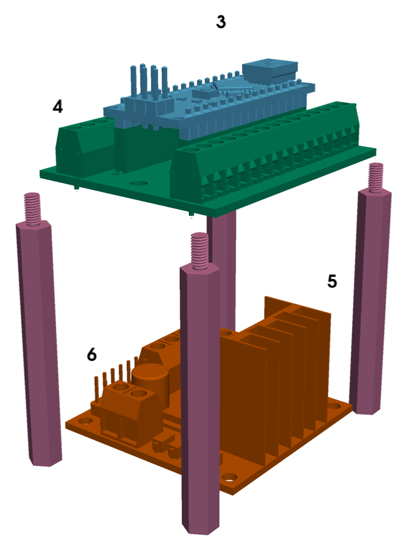

In the 3D model of the robot, the Arduino Nano (3) sits on a terminal adapter (4), which standoffs (5) hold above the L298N driver (6). The firmware reads the motor encoders, computes the speed of each wheel and sends the PWM signals to the L298N. The numbers match those in [mechanical/](../mechanical/README.en.md).

## How it works

|  |  |
| --- | --- |
| 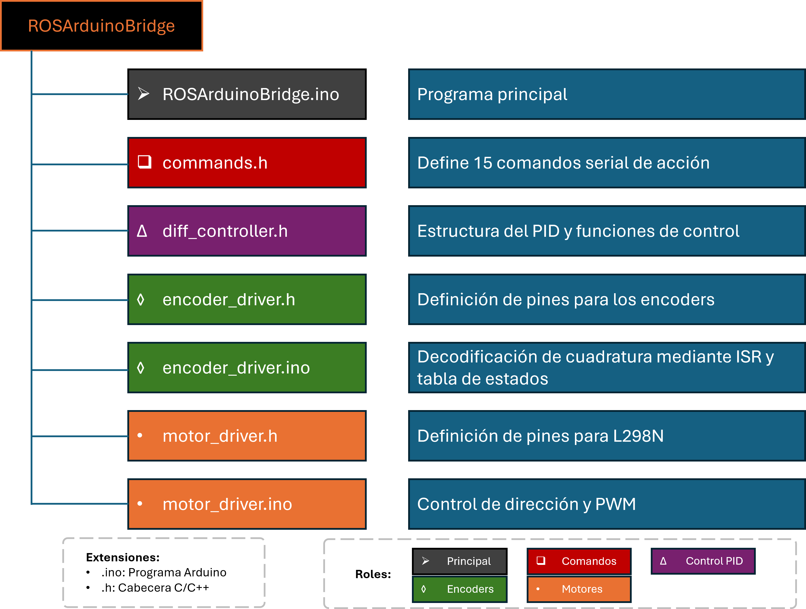 | 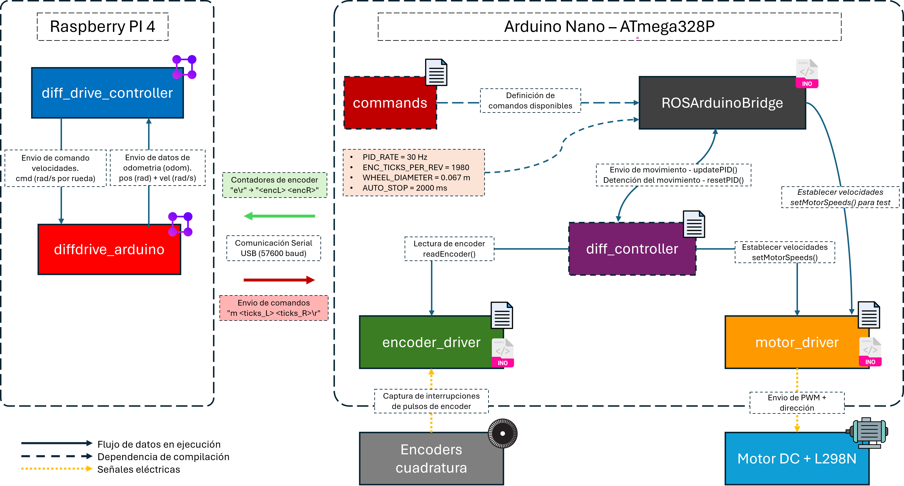 |
| Files of the sketch and what each one does. | The Raspberry Pi and the Arduino talk over USB serial at 57600 baud. The Arduino reads the encoders and drives the motors with the PID. |
| 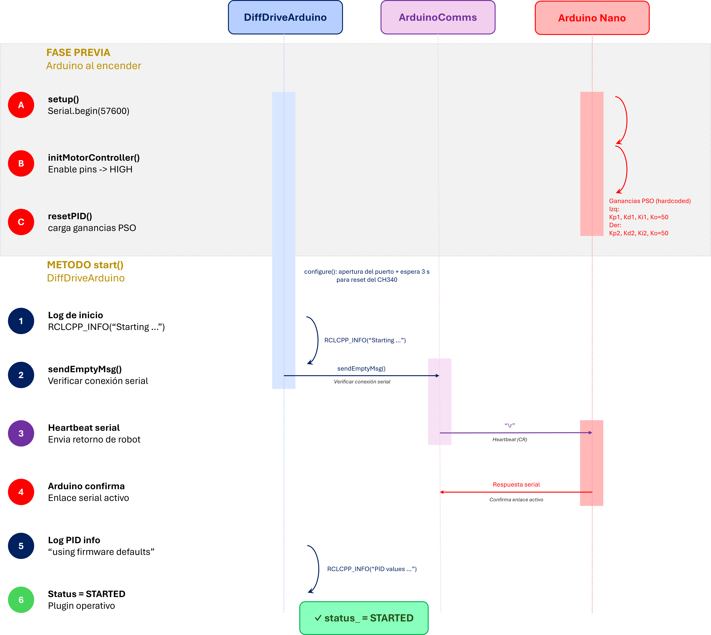 | 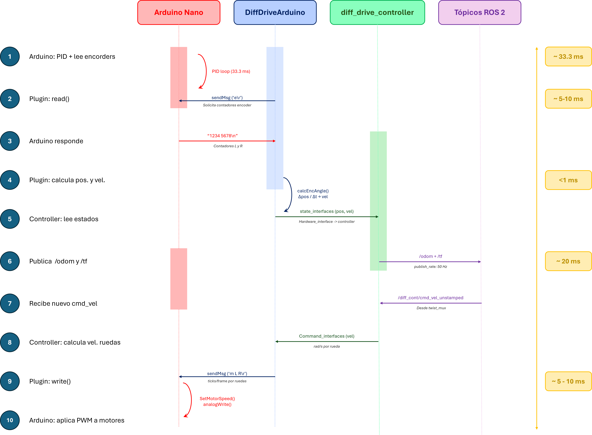 |
| Startup: the Arduino loads the PSO gains, and the DiffDriveArduino plugin opens the port, checks the link and reaches STARTED. | One control cycle in 10 steps, from reading the encoders to the PWM of the motors. |
| 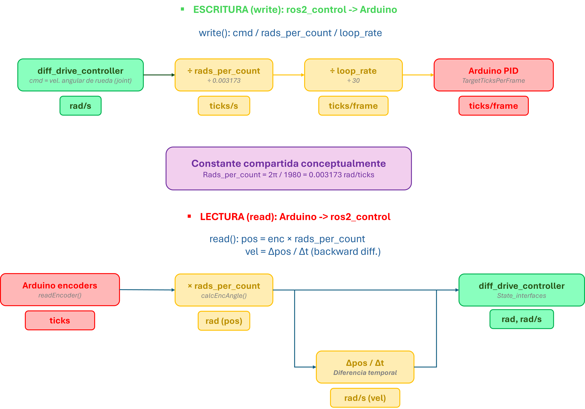 | 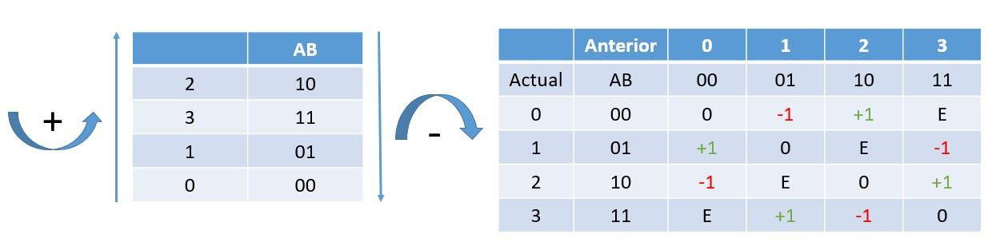 |
| Unit conversion between ros2_control (rad/s) and the Arduino (ticks per cycle), with rads_per_count = 2π / 1980. | States of the encoder channels A and B: each transition adds 1, subtracts 1 or marks an error (E). |
| 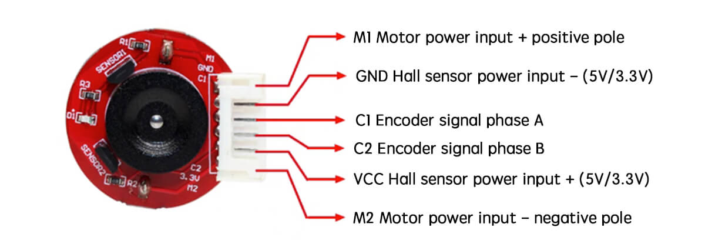 |  |
| Wires of the motor with encoder: motor and Hall sensor power, and channels A and B. |  |

## Tuning results

Plots generated by the scripts in `pid_config/`. Each script saves its plot under the name shown here, so they are not renamed.

| | |
| --- | --- |
| 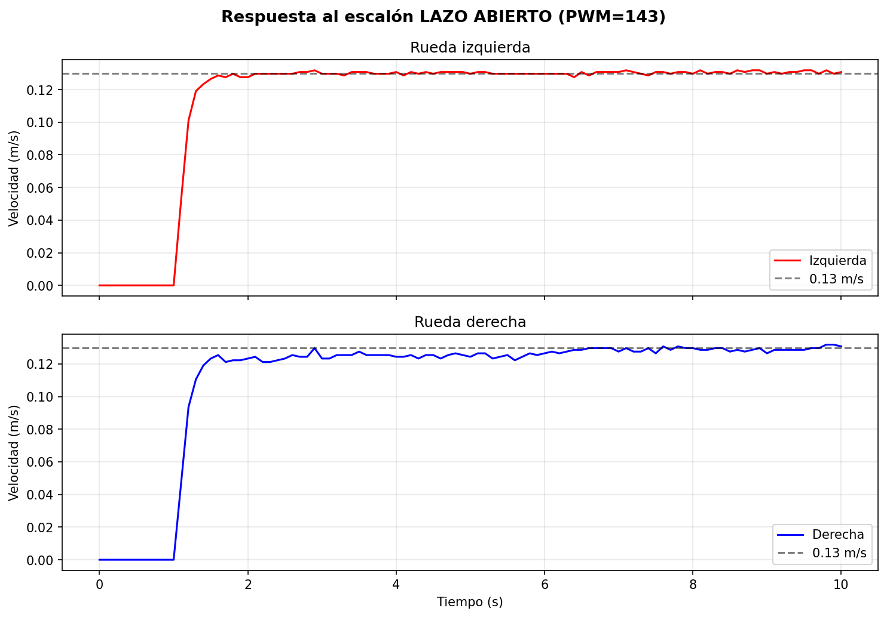 | 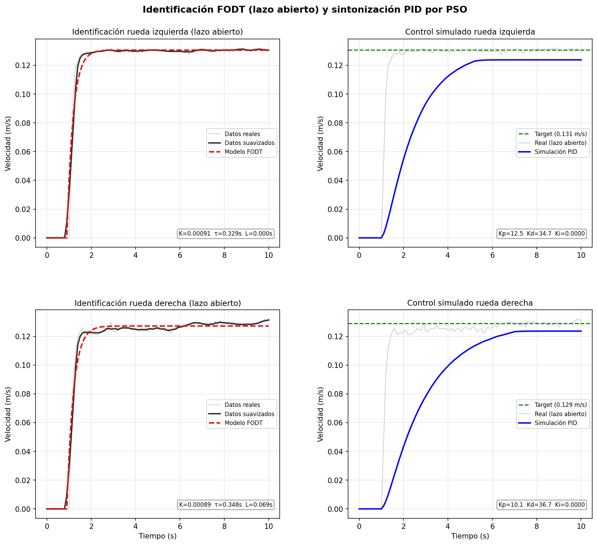 |
| Open-loop step response (PWM 143) of each wheel. `ControlLazoAbierto.py` | Open-loop FOPDT identification and simulated PID control with the PSO gains. `SintonizacionAutomatica.py` |
| 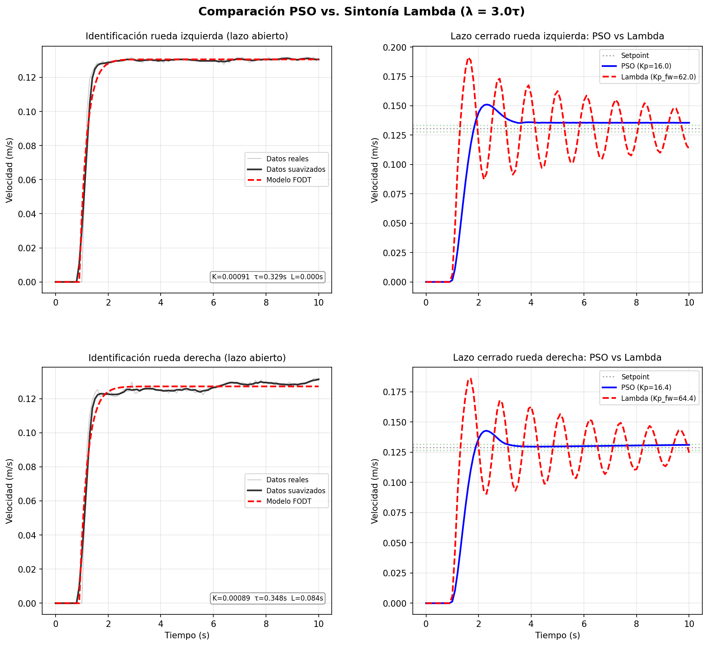 | 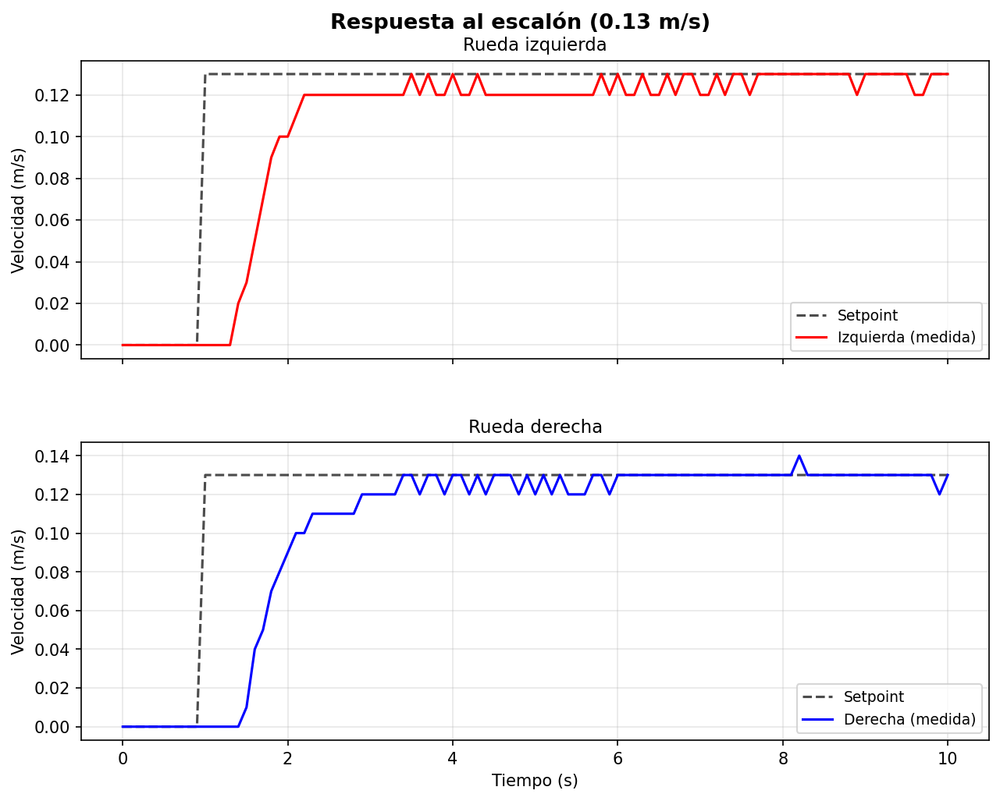 |
| Comparison of PSO tuning and Lambda tuning (λ = 3τ). `SintonizacionLambda.py` | Closed-loop step response at 0.13 m/s, run `pso`. `ControlLazoCerrado.py` |

Other runs of `ControlLazoCerrado.py` at 0.13 m/s: [mvp](pid_config/respuesta_escalon_final_mvp.png), and [error_3](pid_config/respuesta_escalon_final_error_3.png) and [error_4](pid_config/respuesta_escalon_final_error_4.png), with oscillation on the left wheel.

## Notes from the original firmware

Text by Josh Newans, author of the fork this firmware comes from ([joshnewans/ros_arduino_bridge](https://github.com/joshnewans/ros_arduino_bridge)). The gains and physical constants of this robot are described in section 4.4 of the thesis.

### Arduino Motor Controller

This code turns an Arduino into a motor controller!
It provides a simple serial interface to communicate with a high-level computer (e.g. running ROS), and generates the appropriate PWM signals for a motor driver, to drive two motors.

This is a fork of the original code, with some changes, and removal of the ROS nodes (see [this repo](https://github.com/joshnewans/serial_motor_demo) for an alternative). The original README lives in the upstream repository.

As I only have need for a subset of the functionality, I have no idea what does and doesn't work, beyond what is detailed below.
Feedback/improvements are welcome (though no promises on how quickly I'll respond). I currently only use the L298N driver, and the Arduino encoder mode.

### Functionality

The main functionality provided is to receive motor speed requests over a serial connection, and provide encoder feedback.
The original code has provisions for other features - e.g. read/write of digital/analog pins, servo control, but I've never used them.

The main commands to know are

- `e` - Motor responds with current encoder counts for each motor
- `r` - Reset encoder values
- `o <PWM1> <PWM2>` - Set the raw PWM speed of each motor (-255 to 255)
- `m <Spd1> <Spd2>` - Set the closed-loop speed of each motor in *counts per loop* (Default loop rate is 30, so `(counts per sec)/30`
- `p <Kp> <Kd> <Ki> <Ko>` - Update the PID parameters

### Gotchas

Some quick things to note

- There is an auto timeout (default 2s) so you need to keep sending commands for it to keep moving
- PID parameter order is PDI (?)
- Motor speed is in counts per loop
- Default baud rate 57600
- Needs carriage return (CR)
- Make sure serial is enabled (user in dialout group)
- Check out the original readme in the upstream repository for more

### Ideas the original author left open
- Document PID tuning
- Make the speed input counts per second
- Add/test more driver boards
- Add/test other functionality