# firmware

Versión en inglés: [README.en.md](README.en.md)

Código que corre en el Arduino Nano y scripts que sintonizan su control de velocidad.

## Qué va aquí

- `ROSArduinoBridge/`: el sketch del Arduino. Abre `ROSArduinoBridge/ROSArduinoBridge.ino` con el IDE de Arduino. El nombre de la carpeta debe coincidir con el del sketch.
- `pid_config/`: capturas en lazo abierto y cerrado, identificación FOPDT, sintonización PSO y Lambda, análisis de estabilidad y sus resultados.

## Qué no va aquí

- La interfaz de hardware de ROS 2 que habla con este firmware (`src/third_party/diffdrive_arduino/`).
- Pruebas de la tesis (van en `experiments/`).

## Hardware que controla

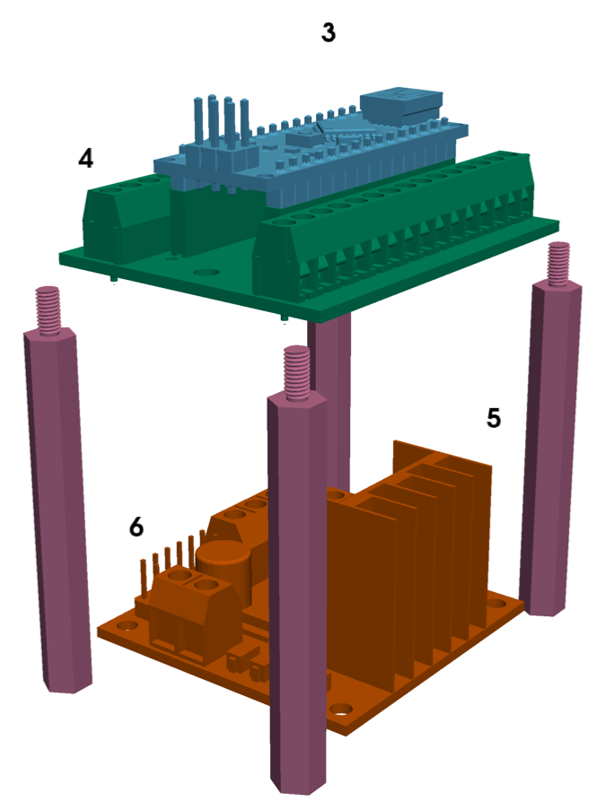

En el modelo 3D del robot, el Arduino Nano (3) va sobre una placa de bornes (4), que se sostiene con separadores (5) sobre el driver L298N (6). El firmware lee los encoders de los motores, calcula la velocidad de cada rueda y envía al L298N las señales PWM. Los números son los mismos de [mechanical/](../mechanical/README.md).

## Cómo funciona

|  |  |
| --- | --- |
| 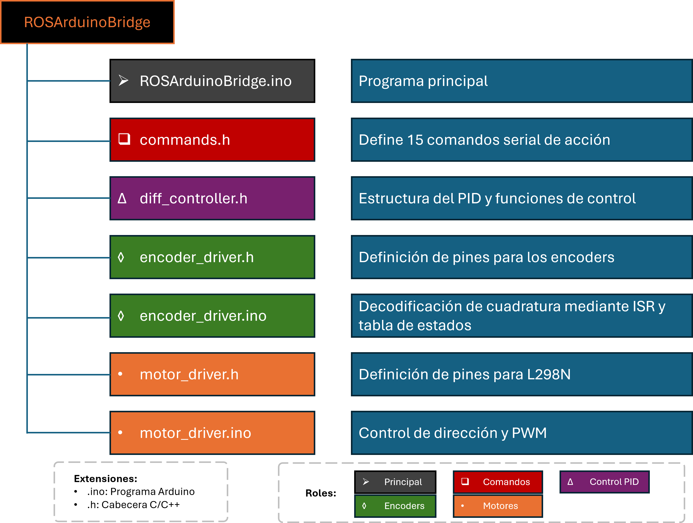 | 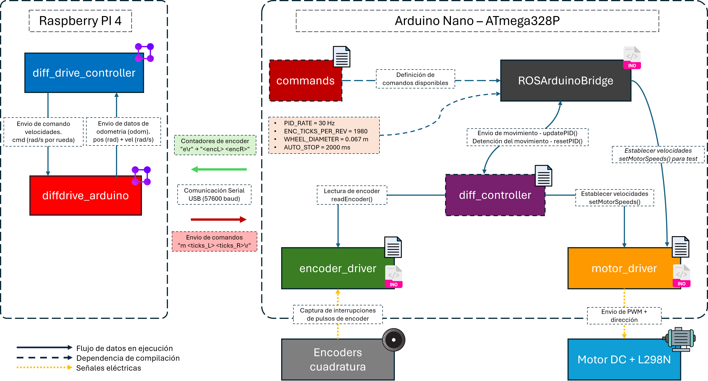 |
| Archivos del sketch y qué hace cada uno. | La Raspberry Pi y el Arduino se comunican por USB serie a 57600 baud. El Arduino lee los encoders y controla los motores con el PID. |
| 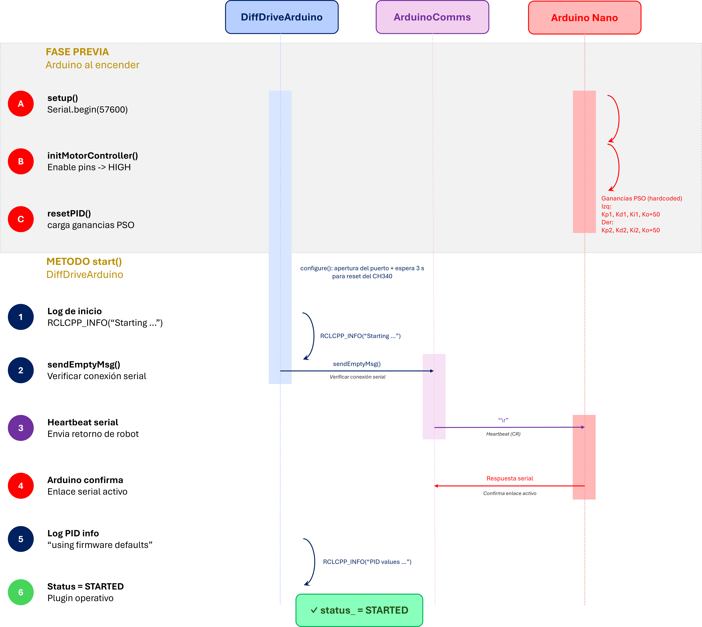 | 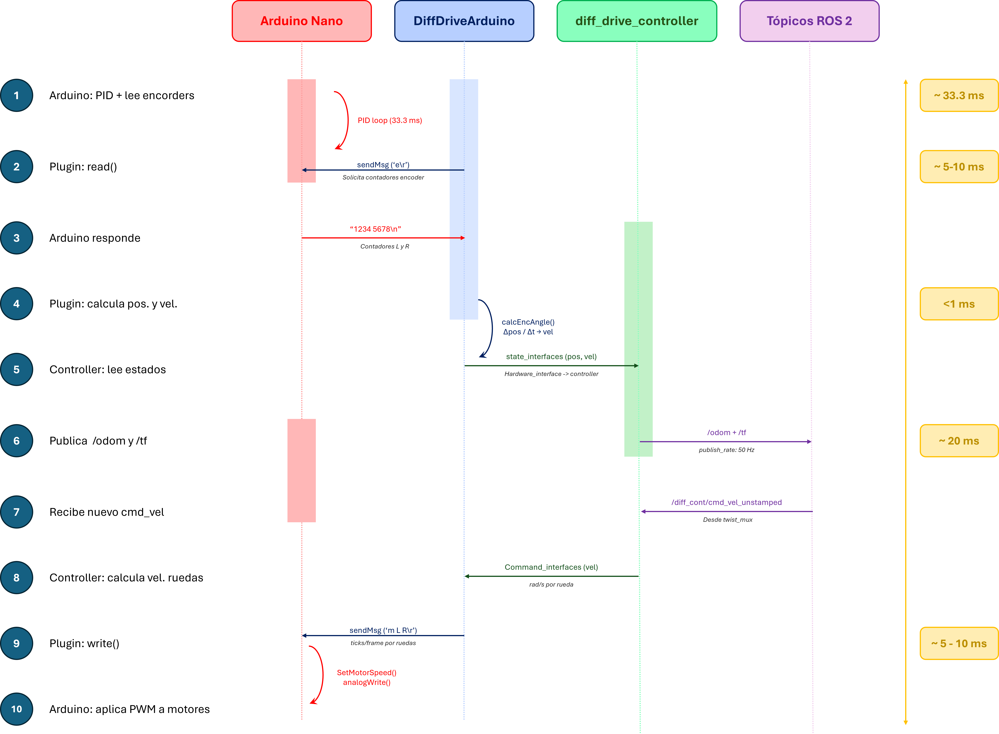 |
| Arranque: el Arduino carga las ganancias PSO, y el plugin DiffDriveArduino abre el puerto, comprueba el enlace y queda en STARTED. | Un ciclo de control en 10 pasos, desde la lectura de los encoders hasta el PWM de los motores. |
| 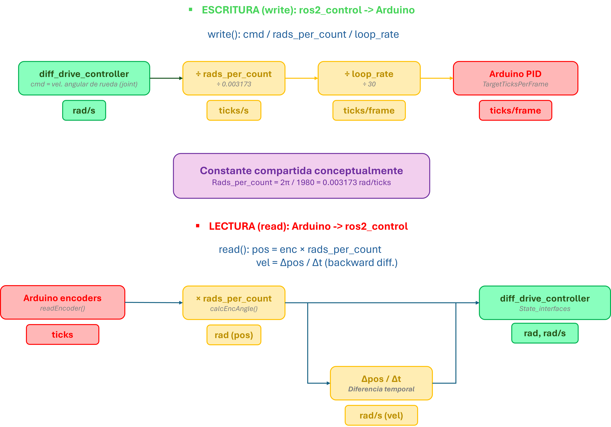 | 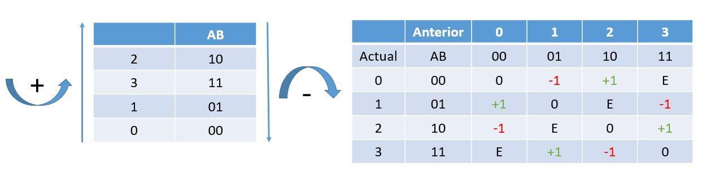 |
| Conversión de unidades entre ros2_control (rad/s) y el Arduino (ticks por ciclo), con rads_per_count = 2π / 1980. | Estados de los canales A y B del encoder: cada transición suma 1, resta 1 o marca un error (E). |
| 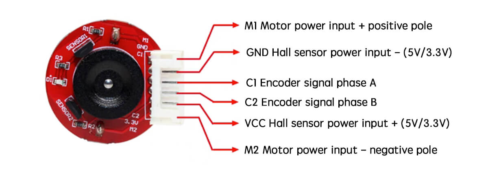 |  |
| Cables del motor con encoder: alimentación del motor y del sensor Hall, y canales A y B. |  |

## Resultados de la sintonización

Gráficos que generan los scripts de `pid_config/`. Cada script guarda su gráfico con el nombre que aparece aquí, así que no se renombran.

| | |
| --- | --- |
| 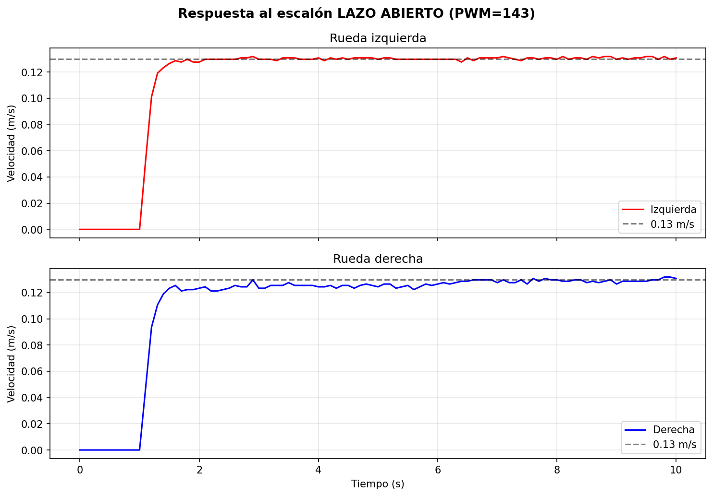 | 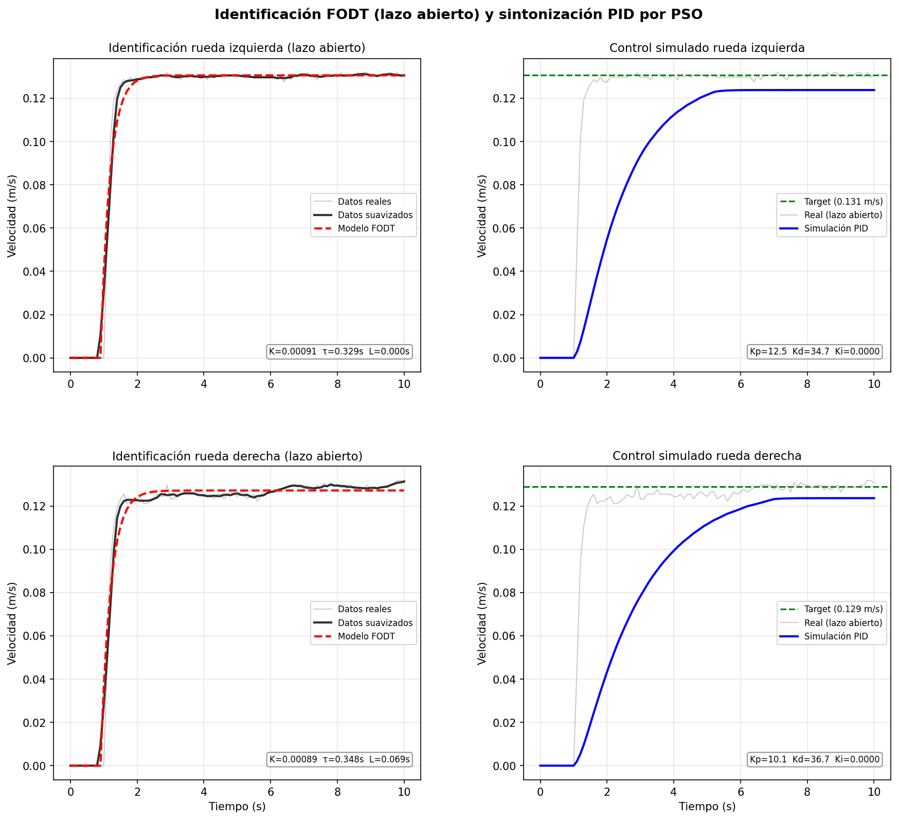 |
| Respuesta al escalón en lazo abierto (PWM 143) de cada rueda. `ControlLazoAbierto.py` | Identificación FOPDT en lazo abierto y control PID simulado con las ganancias de PSO. `SintonizacionAutomatica.py` |
| 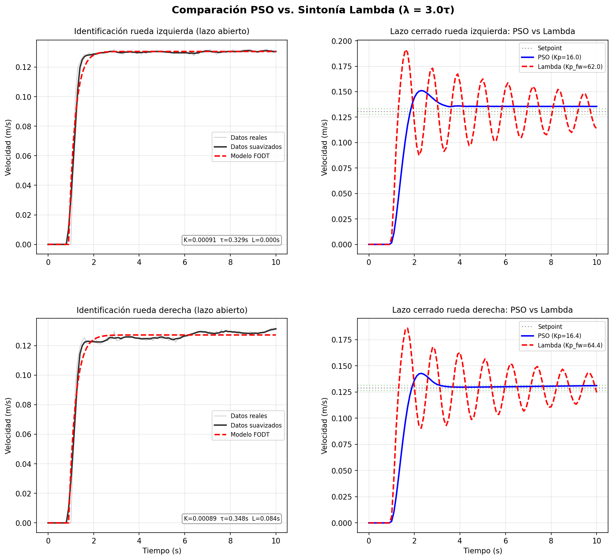 | 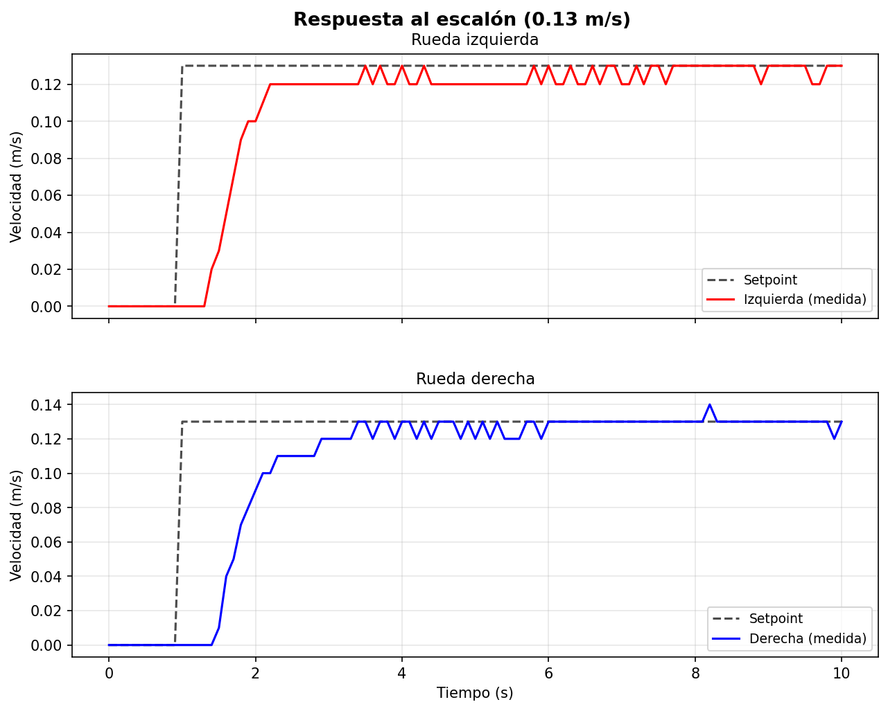 |
| Comparación entre la sintonía PSO y la sintonía Lambda (λ = 3τ). `SintonizacionLambda.py` | Respuesta al escalón de 0,13 m/s en lazo cerrado, corrida `pso`. `ControlLazoCerrado.py` |

Otras corridas de `ControlLazoCerrado.py` a 0,13 m/s: [mvp](pid_config/respuesta_escalon_final_mvp.png), y [error_3](pid_config/respuesta_escalon_final_error_3.png) y [error_4](pid_config/respuesta_escalon_final_error_4.png), con oscilación en la rueda izquierda.

## Notas del firmware original

Texto de Josh Newans, autor de la bifurcación de la que viene este firmware ([joshnewans/ros_arduino_bridge](https://github.com/joshnewans/ros_arduino_bridge)). Las ganancias y constantes físicas de este robot están en la sección 4.4 de la tesis.

### Controlador de motores con Arduino

Este código convierte un Arduino en un controlador de motores. Ofrece una interfaz serie simple para comunicarse con un computador de alto nivel (por ejemplo, uno con ROS) y genera las señales PWM para que un driver mueva dos motores.

Es una bifurcación del código original, con algunos cambios y sin los nodos de ROS (ver [este repositorio](https://github.com/joshnewans/serial_motor_demo) como alternativa). El README original está en el repositorio de origen.

El autor solo usa una parte de las funciones, así que no sabe qué funciona más allá de lo descrito aquí. Solo usa el driver L298N y el modo de encoders del Arduino.

### Funciones

La función principal es recibir velocidades de motor por la conexión serie y devolver la lectura de los encoders. El código original también permite leer y escribir pines digitales y analógicos o controlar servos, pero el autor nunca lo usó.

Los comandos principales son:

- `e`: responde con la cuenta actual de cada encoder.
- `r`: reinicia los encoders.
- `o <PWM1> <PWM2>`: fija el PWM directo de cada motor (de -255 a 255).
- `m <Spd1> <Spd2>`: fija la velocidad en lazo cerrado de cada motor en *cuentas por ciclo*. La frecuencia por defecto es 30, así que es `(cuentas por segundo)/30`.
- `p <Kp> <Kd> <Ki> <Ko>`: actualiza los parámetros del PID.

### Detalles a tener en cuenta

- Hay una detención automática (2 s por defecto), así que hay que seguir enviando comandos para que se siga moviendo.
- El orden de los parámetros del PID es PDI (el autor original no estaba seguro).
- La velocidad del motor está en cuentas por ciclo.
- La velocidad del puerto serie por defecto es 57600 baudios.
- Cada comando necesita un retorno de carro (CR).
- El usuario debe tener acceso al puerto serie (grupo dialout).
- Hay más información en el README original del repositorio de origen.

### Ideas que el autor original dejó abiertas

- Documentar la sintonización del PID.
- Usar cuentas por segundo como unidad de velocidad.
- Agregar y probar más drivers.
- Agregar y probar otras funciones.
