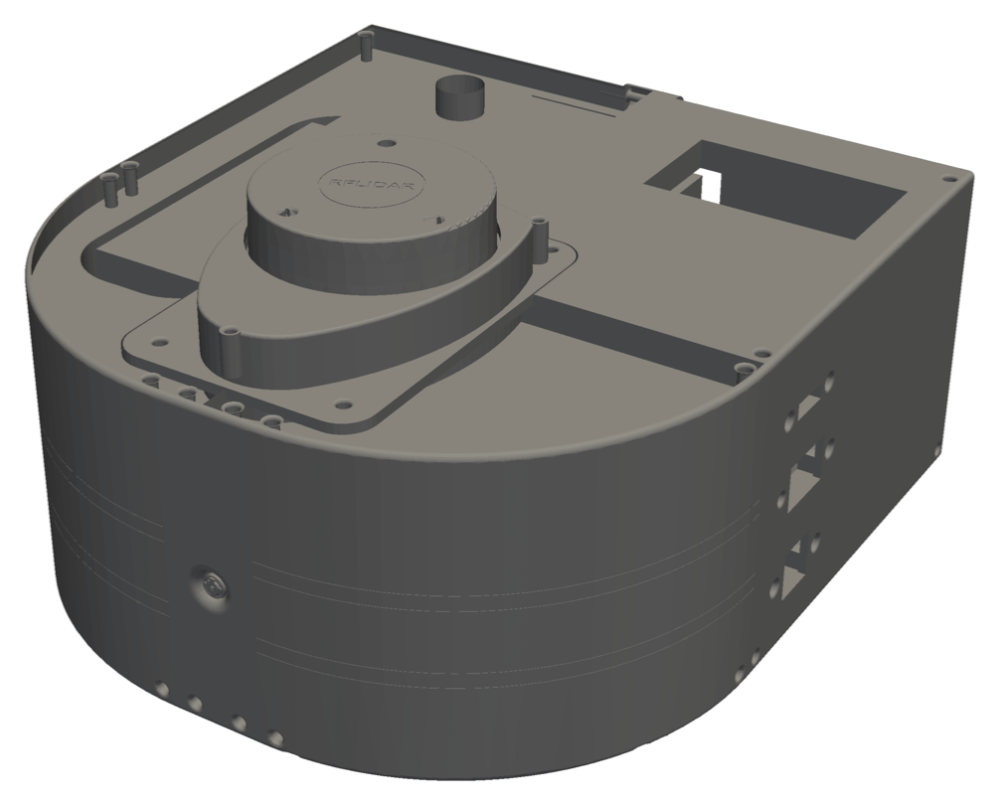
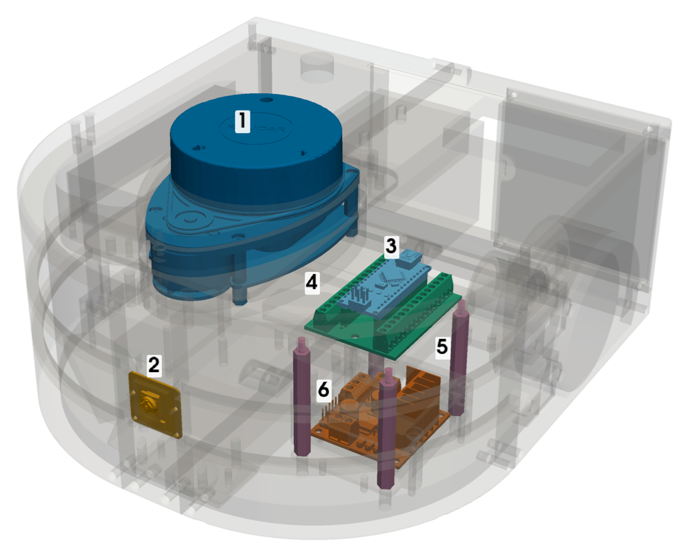
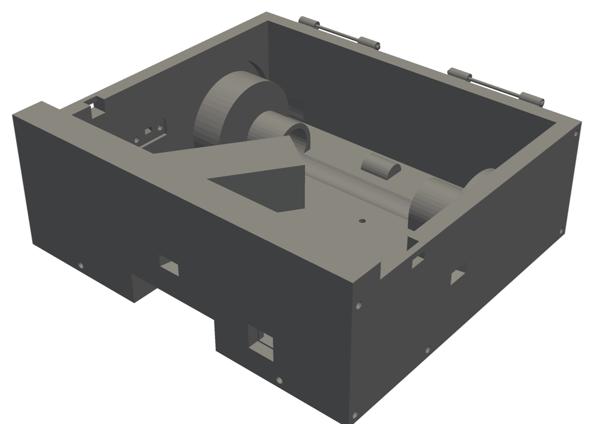
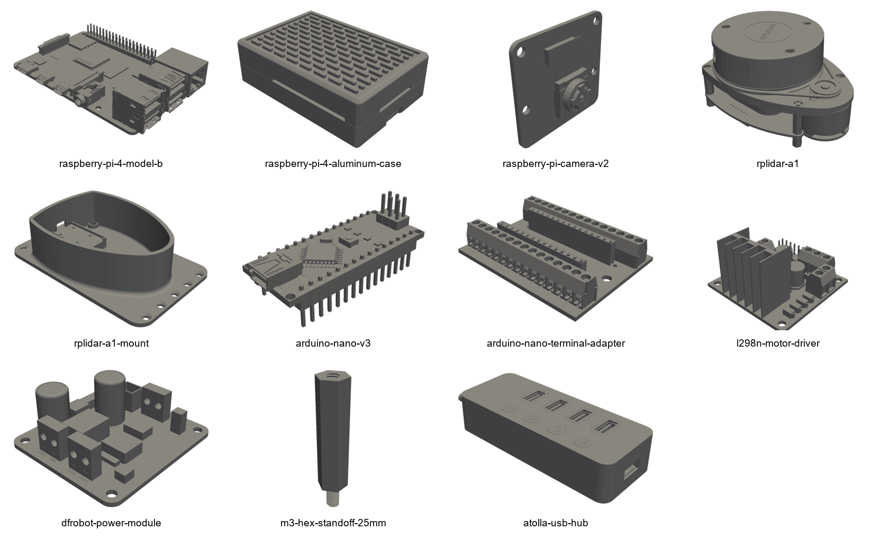

# mechanical

Spanish version: [README.md](README.md)

3D models of the robot and its parts. The chassis and the covers were 3D printed (FDM) in PLA+, taking as reference the Vacuum Robot by marcuslanzoni, as thesis section 4.1.1 says.

<p align="center">
  <a href="robot/robot-v2.stl"></a>
  <a href="robot/robot-v2.stl"></a>
</p>

<p align="center"><em>The built robot (v2) outside and inside. Click an image to rotate the model in 3D on GitHub.</em></p>

## What is inside the robot

The numbers match the image on the right.

| No. | Part | What it does |
| --- | --- | --- |
| 1 | RPLidar A1 | Measures distances 360° around the robot. SLAM Toolbox builds the map from those readings. |
| 2 | Raspberry Pi Camera v2.1 | Sits at the front of the model. The thesis does not use it. |
| 3 | Arduino Nano | Reads the encoders and controls the speed of each wheel with the firmware in [firmware/](../firmware/README.en.md). |
| 4 | Terminal adapter for the Arduino Nano | Connects the wires to the Nano with screws, without soldering. |
| 5 | Standoffs | Hold the terminal adapter above the driver. |
| 6 | L298N driver | Applies the Arduino's PWM signals to the motors. |

The v2 model does not include the Raspberry Pi 4 or the power module. Their models are separate, in `components/`.

## Robot versions



- v1 (`robot/robot-v1`): first chassis design, an open box of 23 × 21 × 10 cm.
- v2 (`robot/robot-v2`): the built robot, 23 × 25 × 15 cm with the LIDAR. It is the one in the photos of [docs/images/](../docs/images/README.en.md).

Each version has its Fusion 360 file (`.f3d` or `.f3z`), its STEP export (`.step`) and a light STL copy to view it on GitHub.

## Parts



The images are not to scale. Table A1.1 of the thesis lists the parts that were bought.

| File in `components/` | What it is | Use |
| --- | --- | --- |
| `raspberry-pi-4-model-b.step` | Raspberry Pi 4 Model B | Runs the ROS 2 hardware interface, reads the LIDAR and talks to the PC. |
| `raspberry-pi-4-aluminum-case.blend` and `.glb` | Aluminum case of the Raspberry Pi 4 | The case of the robot's Raspberry Pi (table A1.1). The `.blend` file is from Blender. |
| `raspberry-pi-camera-v2.step` | Raspberry Pi Camera v2.1 | It is in the v2 model. The thesis does not use it. |
| `rplidar-a1.step` | RPLidar A1 | The laser sensor used for mapping. |
| `rplidar-a1-mount.step` | Mount for the RPLidar A1 | A base with a D-shaped wall. |
| `arduino-nano-v3.step` | Arduino Nano V3 | Runs the motor control firmware. |
| `arduino-nano-terminal-adapter.step` | Deek-Robot terminal adapter for the Arduino Nano | The base board with screw terminals of table A1.1. |
| `l298n-motor-driver.step` | L298N driver | Powers the two motors. |
| `dfrobot-power-module.step` | DFRobot DC-DC buck module | Table A1.1 lists a 25 W DC-DC buck module. |
| `m3-hex-standoff-25mm.step` | M3 hex standoff, 25 mm | Mounting hardware. |
| `atolla-usb-hub.step` | Atolla 4-port USB hub | Table A1.1 lists a USB hub among the development equipment, outside the robot. |

The models that also have an `.f3d` file keep it next to the `.step`, with the same name.

## View and download

- View in 3D: GitHub opens `.stl` files in a viewer where you can rotate, pan and zoom the model. Open [robot-v2.stl](robot/robot-v2.stl) or [robot-v1.stl](robot/robot-v1.stl). The v2 copy has its mesh simplified to 90,000 triangles so GitHub can show it.
- Download everything: the `.step`, `.f3d`, `.f3z`, `.blend` and `.glb` files are in Git LFS, which stores large files outside the history. `.lfsconfig` makes a clone or pull skip them, so the Raspberry Pi does not download 190 MB it does not use. On your disk they show up as small text files until you run, from the repository folder:

  ```bash
  git lfs pull --include="mechanical/**" --exclude=""
  ```

- Download one: open it on GitHub and use the download button.

## What goes here

- `robot/`: the robot designs. Fusion 360 file, STEP export and light STL copy of each version.
- `components/`: part models made by third parties.

## What does not go here

- The images of the models for the documentation (they go in `docs/images/mechanical/`).
- Firmware and code (they go in `firmware/` and `src/`).

## Naming

kebab-case in English with the product name, for example `l298n-motor-driver.step`. Robot versions end in `-v1` or `-v2`. STEP files use the `.step` extension.

## Origin and license

The chassis and covers in `robot/` are the author's own design, made from scratch, and the MIT license of the repository covers them. The Vacuum Robot by marcuslanzoni, licensed CC BY-NC, was a reference only, and none of its files are in the repository. The v2 model includes third-party models (LIDAR, camera, Nano, terminal adapter and L298N), and the models in `components/` are third-party too. The MIT license does not cover what comes from third parties. The origin and license of each one are in [docs/credits.md](../docs/credits.md).
