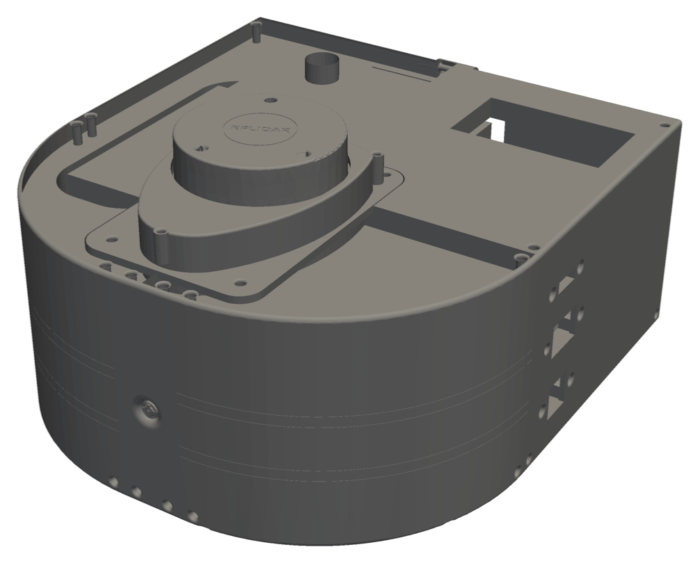
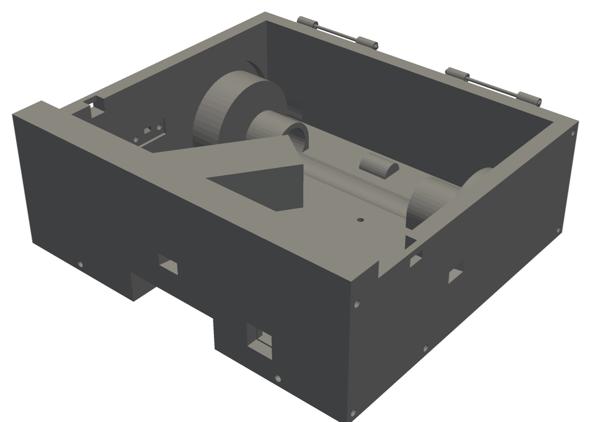
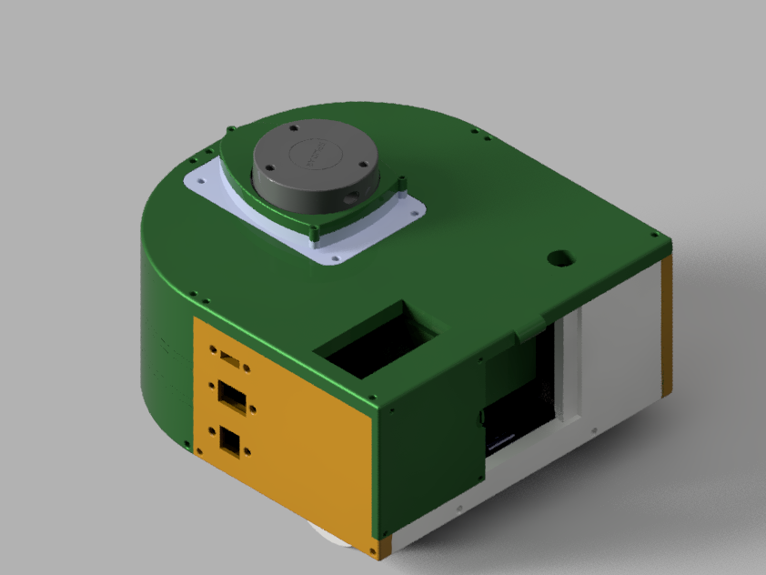
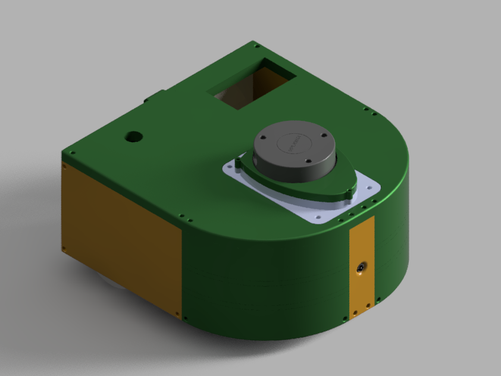
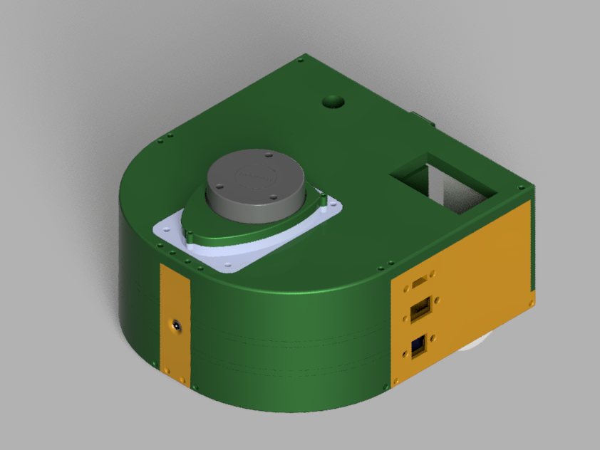
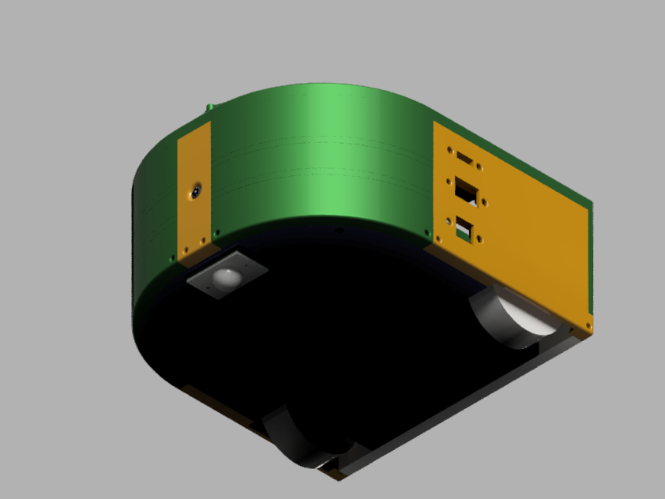
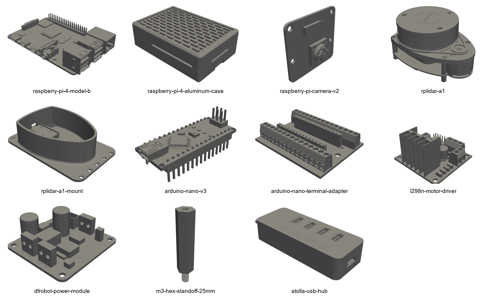

# mechanical

Versión en inglés: [README.en.md](README.en.md)

Modelos 3D del robot y de sus componentes. El chasis y las cubiertas se imprimieron en 3D (FDM) con PLA+, tomando como referencia el Vacuum Robot de marcuslanzoni, como dice la sección 4.1.1 de la tesis.

<p align="center">
  <a href="robot/robot-v2.stl"></a>
  <a href="robot/robot-v2.stl"></a>
</p>

<p align="center"><em>El robot construido (v2) por fuera y por dentro. Haz clic en una imagen para girar el modelo en 3D en GitHub.</em></p>

## Qué hay dentro del robot

Los números son los de la imagen de la derecha.

| N.º | Componente | Qué hace |
| --- | --- | --- |
| 1 | RPLidar A1 | Mide distancias en 360° alrededor del robot. SLAM Toolbox arma el mapa con esas lecturas. |
| 2 | Cámara Raspberry Pi v2.1 | Va en el frente del modelo. La tesis no la usa. |
| 3 | Arduino Nano | Lee los encoders y controla la velocidad de cada rueda con el firmware de [firmware/](../firmware/README.md). |
| 4 | Placa de bornes para el Arduino Nano | Conecta los cables al Nano con tornillos, sin soldar. |
| 5 | Separadores | Sostienen la placa de bornes sobre el driver. |
| 6 | Driver L298N | Aplica a los motores las señales PWM del Arduino. |

El modelo v2 no incluye la Raspberry Pi 4 ni el módulo de alimentación. Sus modelos están aparte, en `components/`.

## Versiones del robot



- v1 (`robot/robot-v1`): primer diseño del chasis, una caja abierta de 23 × 21 × 10 cm.
- v2 (`robot/robot-v2`): el robot construido, de 23 × 25 × 15 cm con el LIDAR. Es el que aparece en las fotos de [docs/images/](../docs/images/README.md).

Cada versión tiene su archivo de Fusion 360 (`.f3d` o `.f3z`), su exportación STEP (`.step`) y una copia STL liviana para verla en GitHub.

## Renders y plano de v2

|  |  |
| --- | --- |
|  |  |
| Vista superior izquierda, frente. | Vista superior izquierda, parte trasera. |
|  |  |
| Vista superior derecha. | Vista inferior derecha. |

Renders de Fusion 360. El plano con las medidas del robot está en [robot/robot-v2-drawing.pdf](robot/robot-v2-drawing.pdf).

## Componentes



Las imágenes no están a escala. La tabla A1.1 de la tesis lista los componentes que se compraron.

| Archivo en `components/` | Qué es | Uso |
| --- | --- | --- |
| `raspberry-pi-4-model-b.step` | Raspberry Pi 4 Model B | Corre la interfaz de hardware de ROS 2, lee el LIDAR y se comunica con el PC. |
| `raspberry-pi-4-aluminum-case.blend` y `.glb` | Carcasa de aluminio de la Raspberry Pi 4 | Es la carcasa de la Raspberry del robot (tabla A1.1). El `.blend` es de Blender. |
| `raspberry-pi-camera-v2.step` | Cámara Raspberry Pi v2.1 | Está en el modelo v2. La tesis no la usa. |
| `rplidar-a1.step` | RPLidar A1 | El sensor láser del mapeo. |
| `rplidar-a1-mount.step` | Soporte para el RPLidar A1 | Una base con una pared en forma de D. |
| `arduino-nano-v3.step` | Arduino Nano V3 | Corre el firmware de control de los motores. |
| `arduino-nano-terminal-adapter.step` | Placa de bornes Deek-Robot para el Arduino Nano | La placa base con bornes de tornillo de la tabla A1.1. |
| `l298n-motor-driver.step` | Driver L298N | Alimenta los dos motores. |
| `dfrobot-power-module.step` | Módulo reductor DC-DC de DFRobot | La tabla A1.1 lista un módulo reductor DC-DC de 25 W. |
| `m3-hex-standoff-25mm.step` | Separador hexagonal M3 de 25 mm | Tornillería de montaje. |
| `atolla-usb-hub.step` | Hub USB Atolla de 4 puertos | La tabla A1.1 lista un hub USB entre los equipos de desarrollo, fuera del robot. |

Los modelos que también tienen un `.f3d` lo guardan junto al `.step`, con el mismo nombre.

## Ver y descargar

- Ver en 3D: GitHub abre los archivos `.stl` en un visor donde se puede girar, mover y acercar el modelo. Abre [robot-v2.stl](robot/robot-v2.stl) o [robot-v1.stl](robot/robot-v1.stl). La copia de v2 tiene la malla simplificada a 90 000 triángulos para que GitHub la pueda mostrar.
- Descargar todo: los archivos `.step`, `.f3d`, `.f3z`, `.blend` y `.glb` están en Git LFS, que guarda los archivos grandes fuera del historial. `.lfsconfig` hace que un clone o un pull no los descargue, así la Raspberry no baja 190 MB que no usa. En tu disco aparecen como archivos de texto pequeños hasta que ejecutas, desde la carpeta del repositorio:

  ```bash
  git lfs pull --include="mechanical/**" --exclude=""
  ```

- Descargar uno: ábrelo en GitHub y usa el botón de descarga.

## Qué va aquí

- `robot/`: los diseños del robot. Archivo de Fusion 360, exportación STEP y copia STL liviana de cada versión, y el plano de v2 en PDF.
- `components/`: modelos de componentes hechos por terceros.

## Qué no va aquí

- Las imágenes de los modelos para la documentación (van en `docs/images/mechanical/`).
- Firmware y código (van en `firmware/` y `src/`).

## Nombres

kebab-case en inglés con el nombre del producto, por ejemplo `l298n-motor-driver.step`. Las versiones del robot terminan en `-v1` o `-v2`. Los STEP usan la extensión `.step`.

## Origen y licencia

El chasis y las cubiertas de `robot/` son un diseño propio del autor, hecho desde cero, y los cubre la licencia MIT del repositorio. El Vacuum Robot de marcuslanzoni, con licencia CC BY-NC, fue solo una referencia, y ningún archivo suyo está en el repositorio. El modelo v2 incluye modelos de terceros (LIDAR, cámara, Nano, placa de bornes y L298N), y los modelos de `components/` también son de terceros. La licencia MIT no cubre lo que viene de terceros. El origen y la licencia de cada uno están en [docs/credits.md](../docs/credits.md).
