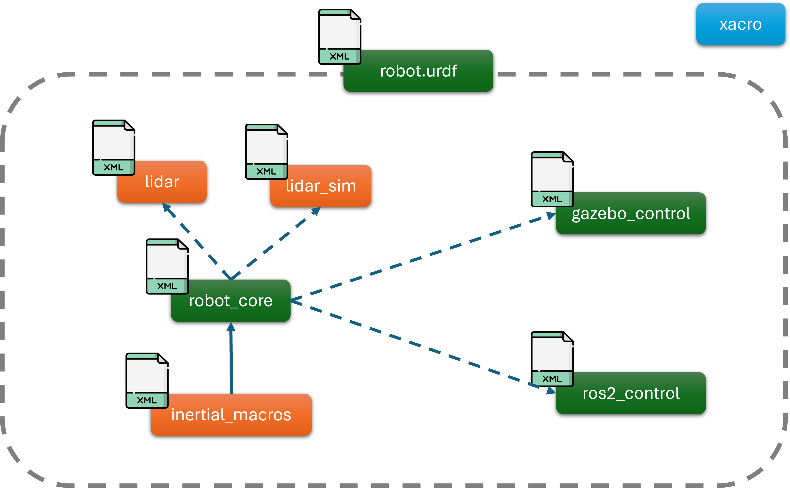
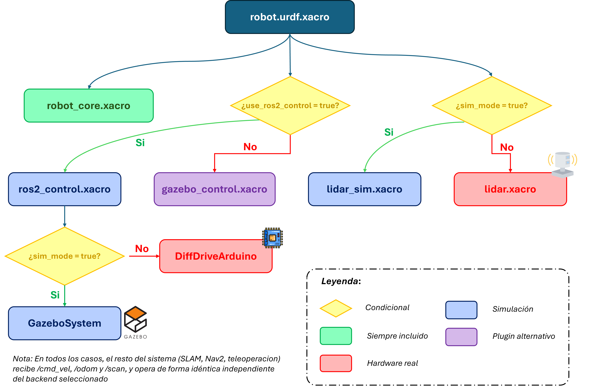
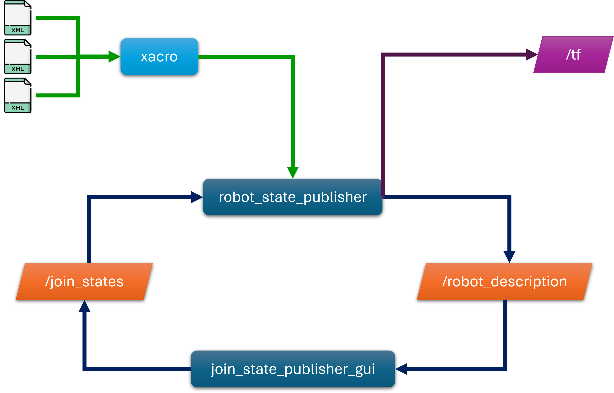
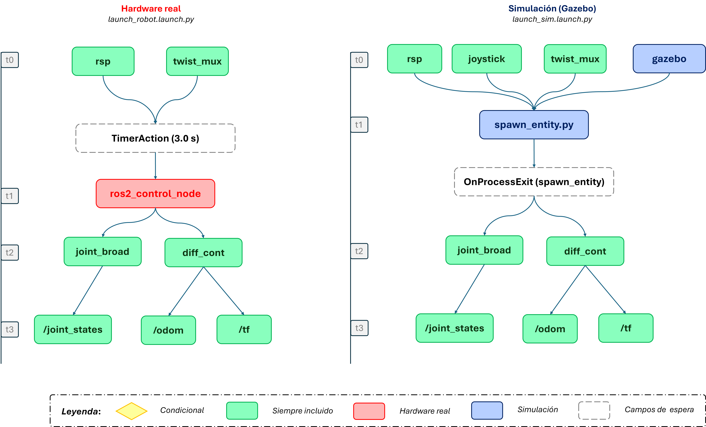
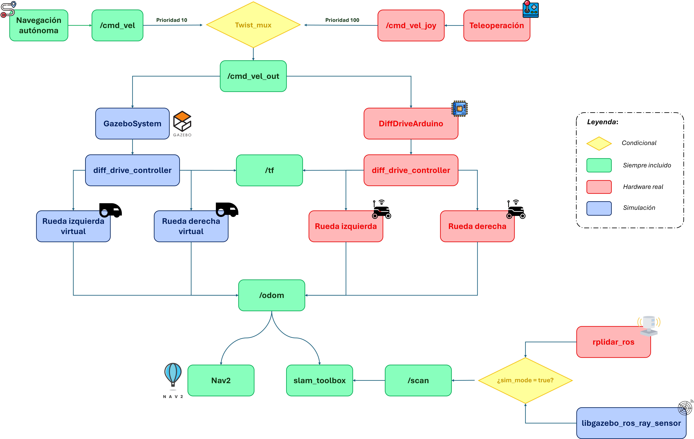
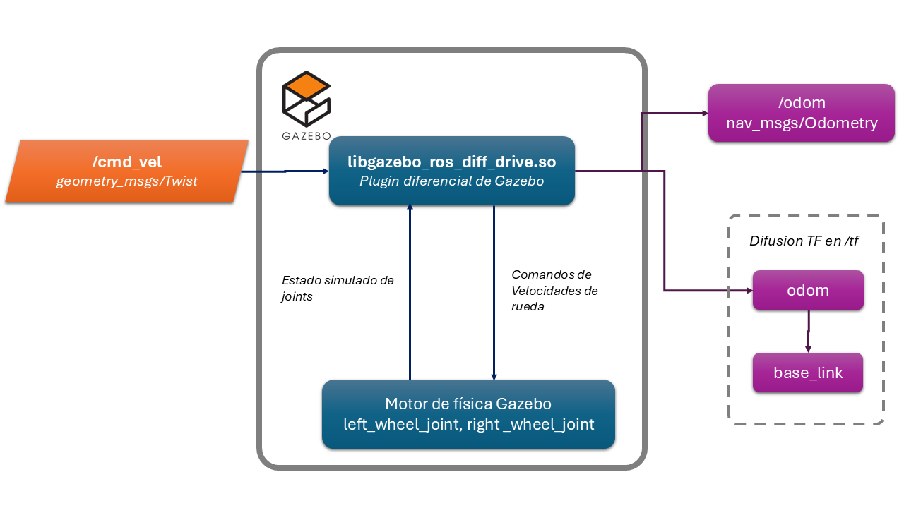
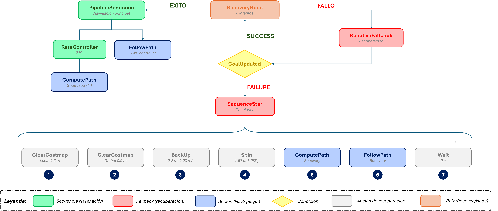

# src

Spanish version: [README.md](README.md)

ROS 2 packages of the workspace. colcon finds them at any depth inside this folder.

## What goes here

- `articubot_one/`: URDF and xacro robot model, launch files, and the control, SLAM, Nav2, exploration and simulation parameters.
- `serial_motor_demo/`: serial motor test package and its messages.
- `third_party/`: packages that come from other projects. Their origin and license are in `docs/credits.md`.

## What does not go here

- Arduino firmware (it goes in `firmware/`).
- Launch scripts (they go in `scripts/launch/`).
- Thesis experiments and their results (they go in `experiments/`).
- colcon output (`build/`, `install/` and `log/` stay at the root and are ignored).

## How they work together

|  |  |
| --- | --- |
|  |  |
| xacro files that make up the robot model, in `articubot_one/description/`. | How `robot.urdf.xacro` chooses between the real robot and simulation with `use_ros2_control` and `sim_mode`. |
|  |  |
| xacro builds the robot description, robot_state_publisher publishes it and produces /tf. | Startup order of `launch_robot.launch.py` (real robot) and `launch_sim.launch.py` (Gazebo). |
|  |  |
| twist_mux gives teleoperation priority over navigation, and diff_drive_controller moves the wheels of the real robot or of Gazebo and publishes /odom. | The Gazebo differential drive plugin (`gazebo_control.xacro`), the alternative to ros2_control in simulation. |
|  |  |
| Nav2 behavior tree: it plans with ComputePath, follows the path with FollowPath and, if that fails, tries 7 recovery actions. |  |

## Naming

Each package uses the name its `package.xml` declares, in snake_case.
