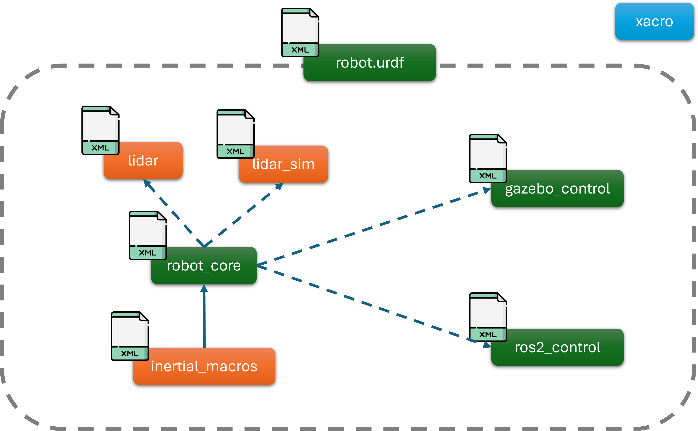
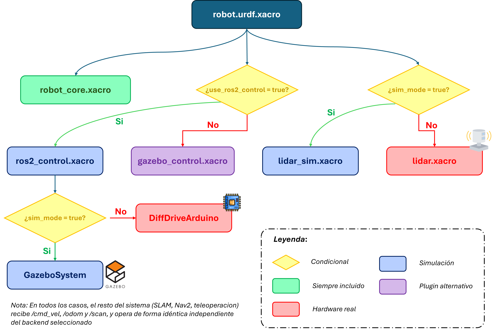
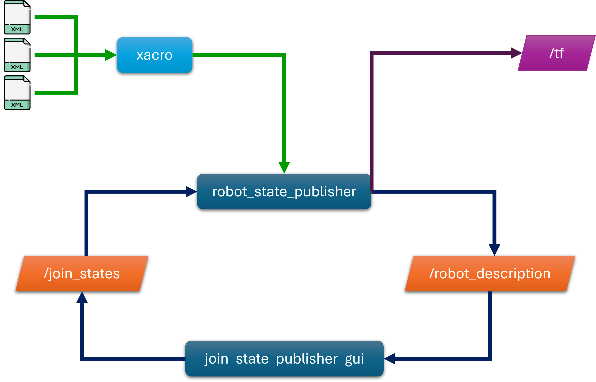
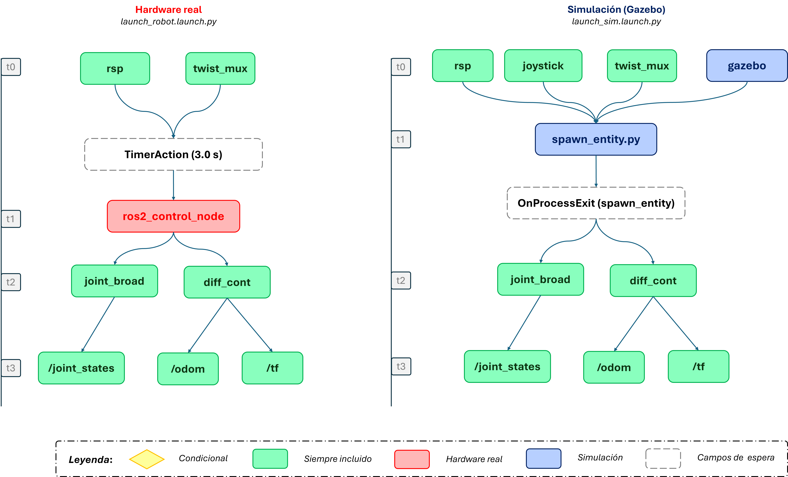
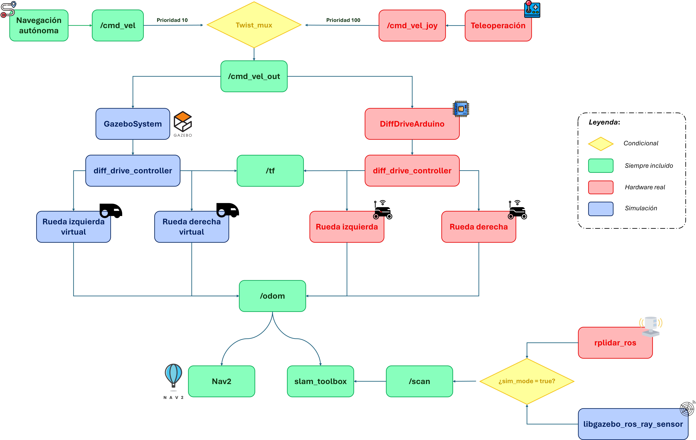
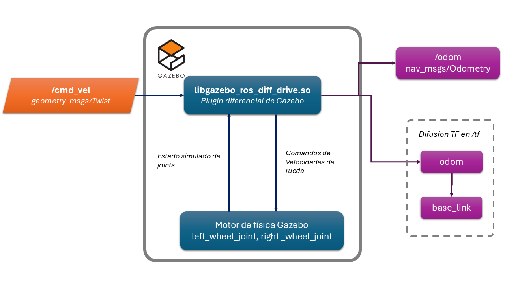
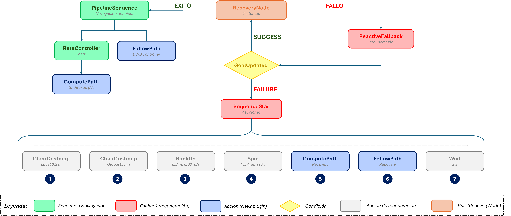

# src

Versión en inglés: [README.en.md](README.en.md)

Paquetes de ROS 2 del workspace. colcon los busca en cualquier nivel dentro de esta carpeta.

## Qué va aquí

- `articubot_one/`: modelo URDF y xacro del robot, archivos launch y parámetros de control, SLAM, Nav2, exploración y simulación.
- `serial_motor_demo/`: paquete de prueba de motores por puerto serie y sus mensajes.
- `third_party/`: paquetes que vienen de otros proyectos. Su origen y licencia están en `docs/credits.md`.

## Qué no va aquí

- Firmware del Arduino (va en `firmware/`).
- Scripts de arranque (van en `scripts/launch/`).
- Pruebas de la tesis y sus resultados (van en `experiments/`).
- Salidas de colcon (`build/`, `install/` y `log/` quedan en la raíz y están ignoradas).

## Cómo funcionan juntos

|  |  |
| --- | --- |
|  |  |
| Archivos xacro que forman el modelo del robot, en `articubot_one/description/`. | Cómo `robot.urdf.xacro` elige entre robot real y simulación con `use_ros2_control` y `sim_mode`. |
|  |  |
| xacro arma la descripción del robot, robot_state_publisher la publica y genera /tf. | Orden de arranque de `launch_robot.launch.py` (robot real) y `launch_sim.launch.py` (Gazebo). |
|  |  |
| twist_mux da prioridad a la teleoperación sobre la navegación, y diff_drive_controller mueve las ruedas del robot real o de Gazebo y publica /odom. | El plugin diferencial de Gazebo (`gazebo_control.xacro`), la alternativa a ros2_control en simulación. |
|  |  |
| Árbol de comportamiento de Nav2: planifica con ComputePath, sigue la ruta con FollowPath y, si falla, prueba 7 acciones de recuperación. |  |

## Nombres

Cada paquete usa el nombre que declara su `package.xml`, en snake_case.
